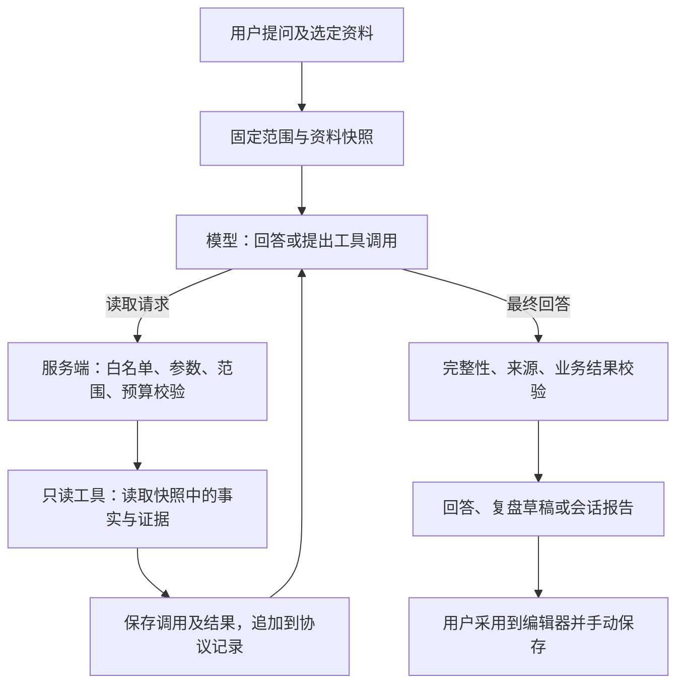
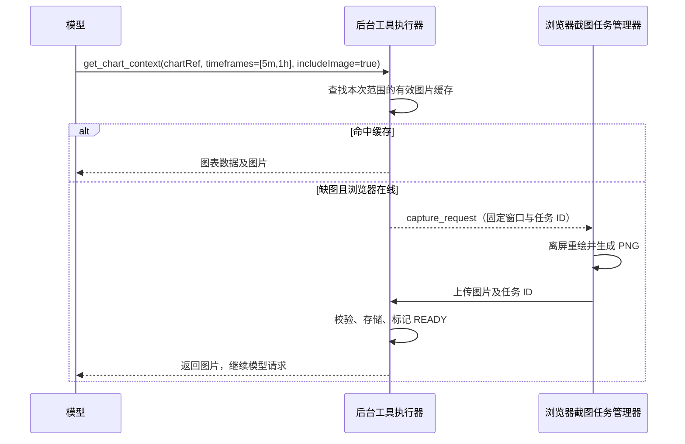

# AI Function Calling 设计方案

日期：2026-10-16。状态：调研与讨论稿，未实施。已补充首版工具精简及逐工具契约。

本次只新增本设计文档，没有开发工具执行器、修改数据库或调用真实模型。以当前 `ai-dev` 工作区代码及已确认的产品需求为基线；旧规划和参考附件中的开发指令、能力验证按钮、技能模型覆盖等不作为本次需求。

## 1. 建议采用的方案

采用“固定资料快照 + 服务端只读工具 + 有上限的模型调用循环”。模型决定需要什么资料，应用检查并执行读取，应用继续控制数据范围、时间边界、整会话覆盖和正式保存。

第一版仍覆盖 K 线回放的单笔事后复盘、单个回放会话归纳与同范围追问。保留唯一全局机器人、统一的大模型配置和当前复盘采用流程。跨会话、独立交易日志、蒙特卡洛、知识库、即时训练辅导分别留作扩展，不能因为工具可用就自动开放。



不以大模型直接连接 SQLite，不开放通用 SQL，也不需要先引入 MCP、LangChain 或完整 Agent 框架。第一版用现有 TypeScript、Zod、Prisma、worker 和流式接口即可表达上述边界。这是针对本系统规模的架构建议。

## 2. 代码调研结论

| 当前实现 | 代码证据 | 对设计的影响 |
| --- | --- | --- |
| 请求未传 `tools`；消息只有 system/user/assistant；收到 `tool_calls` 会拒绝；只接受完整的 `stop` 正文。 | [provider.ts](../lib/ai/provider.ts) | 要增加“模型中间轮次”类型及协议解析，不能只添加几个函数定义。 |
| 普通任务目前最多一次模型调用。会话分析采用固定批次、分层压缩、最终汇总。 | [runs.ts](../lib/ai/runs.ts) | 普通对话需要独立的循环预算；整会话保留程序调度。 |
| Context 已固定交易、模板、草稿、图表、事件、统计以及 projection、版本、截止序号；当前图表只按选定显示周期准备。 | [context.ts](../lib/ai/context.ts) | 基础工具复用既有快照；多周期图表需要增加受控派生窗口，不能声称当前快照已包含其他周期。 |
| 图表准备和截图在浏览器执行，后台 worker 只是 Node 进程；AI 已实现截图后上传。 | [capture.ts](../components/ai/capture.ts)、[chart-snapshot.ts](../lib/market-replay/chart-snapshot.ts)、[worker](../scripts/ai-analysis-worker.ts) | 上传后后台可以使用；若需临时触发浏览器生成，新增客户端任务桥接即可，不必一律引入服务端渲染。 |
| 已存思考展示元数据，但普通历史仅重放正文，没有完整工具协议记录。 | [response-details.ts](../lib/ai/response-details.ts)、[runs.ts](../lib/ai/runs.ts) | 展示记录与供应商续传记录必须分开，不能依靠当前一份最终思考元数据恢复工具循环。 |
| 总体指标使用完整持仓 `PaperTrade` 扣费净额；Setup/方向分组是 FIFO 日志行的未扣费价差。 | [statistics.ts](../lib/ai/statistics.ts)、[Prisma](../prisma/schema.prisma) | 工具结果必须标注统计单位；当前数据不能直接回答“哪个 Setup 的扣费净收益最高”。 |
| 草稿和报告已有 Zod、真实来源 ID 校验及原文冲突检查。 | [schema.ts](../lib/ai/schema.ts)、[runs.ts](../lib/ai/runs.ts)、[AI API](../app/api/ai/%5B...path%5D/route.ts) | 保留原业务校验，并增加“来源是否实际读取”的检查。 |

既有快照准备仍可能读取整个获准范围，这与“只向模型按需发送”是两个层面。首版主要改变模型取数方式，不承诺同时消除浏览器准备图表或服务端建立快照的成本。第 15—18 节另列出必要的快照补充，均为待开发项，不能把现有字段名直接当作已满足新契约的证据。

## 3. 官方协议调研与兼容决定

### 3.1 Chat Completions 的基本闭环

请求携带函数定义；模型返回工具名称、参数和调用 ID；应用执行后以匹配的 `tool_call_id` 返回结果，再请求模型继续。流式工具参数需要按 `index` 累积，名称和 ID 可能只出现在起始分片。`finish_reason=tool_calls` 是有效中间状态，不是最终回答。[OpenAI Function Calling](https://developers.openai.com/api/docs/guides/function-calling)、[流式事件](https://developers.openai.com/api/reference/resources/chat/subresources/completions/streaming-events)

方案：完整接收并验证后才执行；支持同轮多个调用的解析，第一版服务端串行执行。支持相应参数的适配器可请求 `parallel_tool_calls=false`；通用兼容适配器不盲发厂商未支持的可选字段。

### 3.2 strict 不能替代业务校验

OpenAI strict schema 要求对象禁止额外属性、所有声明字段均为 required，可用 nullable 表达可选语义。DeepSeek 当前 strict 属 Beta，需要用户选择相应 `/beta` 地址，且支持的 schema 子集存在差异，例如字符串和数组长度约束不能一概照搬。[OpenAI strict](https://developers.openai.com/api/docs/guides/function-calling#strict-mode)、[DeepSeek Tool Calls](https://api-docs.deepseek.com/zh-cn/guides/tool_calls/)

方案：维护一个服务端 Zod 契约，另生成各适配器可接受的 JSON Schema。严格模式只在已适配的协议配置中开启；通用协议默认省略 `strict`。服务端始终执行长度、枚举、分页、范围及时间校验，不自动更换用户 Base URL。

### 3.3 DeepSeek 思考字段是必须单独处理的差异

DeepSeek 官方说明：携带 tools 的请求，后续请求须完整回传所保留历史中的 `reasoning_content`，包括未实际调用工具的相关轮次。不能沿用当前“所有后续请求都只保留正文”的做法。[DeepSeek 思考模式](https://api-docs.deepseek.com/zh-cn/guides/thinking_mode/)

方案：DeepSeek 适配策略保留每个完整 assistant 轮次的正文、工具调用及服务实际返回的思考字段，按官方格式续传。显示层可以折叠，协议层不能因此丢弃或截断必需字段；缺字段的旧消息不伪造补齐。仅保存供应商实际提供的内容，不要求模型额外泄露隐藏思考。

当前 DeepSeek 思考模式不接受 `tool_choice=required` 或指定函数，故采用 `auto`，收束使用支持的 `none`，不能靠强制指定工具来补足业务校验。[DeepSeek 对话 API](https://api-docs.deepseek.com/api/create-chat-completion/)

DeepSeek 对 Chat Completions 中间插入工具调用还有限制，故只追加真实模型调用及匹配结果，不把程序预加载伪装成模型曾调用的工具。[DeepSeek Tool Calls](https://api-docs.deepseek.com/zh-cn/guides/tool_calls/)

### 3.4 “兼容 OpenAI”不是统一能力保证

Ollama 的 OpenAI 兼容接口列出了 tools、流式和图片支持；实际仍需选择相应模型与服务版本。vLLM 的自动调用还依赖服务端启用工具选择和适配的 parser/chat template。[Ollama 兼容接口](https://docs.ollama.com/api/openai-compatibility)、[vLLM Tool Calling](https://docs.vllm.ai/en/stable/features/tool_calling/)

当前 OpenAI 官方指南还明确，GPT-6 Astra、GPT-6.1 Sol 的工具调用要求 Responses。因而不能承诺当前 Chat Completions 适配器覆盖所有 OpenAI 模型。[OpenAI Function Calling](https://developers.openai.com/api/docs/guides/function-calling)

第一版优先当前 DeepSeek 与通用 Chat Completions 工具协议，适配层保留 Responses 扩展位。原生 Ollama `/api/chat`、Anthropic Messages 不是同一 wire 协议，不混用。对代理服务的 DeepSeek 行为提供端点级兼容策略，不通过模型名称猜测。

“测试连接”保持现有简短请求，不增加工具验证按钮，也不在保存、打开设置时探测。真实运行的成功可记录兼容信息；普通文本回答没有调用工具，不能被记录成“不支持工具”。明确不支持时告知，并由用户选择使用现有固定资料继续；不静默重试或切换模型。

将“支持工具”和“支持工具流”分别适配：后者不可用但前者可用时，可使用非流式工具轮次、流式最终正文。该策略应在运行前固定，不在付费请求断流后偷偷再发一遍。

## 4. 首版工具集合

首版从原先 7 个工具精简为 **5 个**。工具由应用注册，参数仅表达领域查询，不接收 Prisma where、SQL、路径或 URL。函数名与返回契约带独立版本，运行开始后固定。

| 工具 | 主要参数 | 返回内容与边界 |
| --- | --- | --- |
| `list_trade_records` | filters、cursor、limit | 在本次范围内定位 FIFO 日志记录、筛选支持和反例；返回摘要与 tradeRef，不预读完整复盘。详见第 15 节。 |
| `get_trade_record` | tradeRef、sections[]、cursor、limit | 读取交易事实、已保存复盘、历史检查快照及可靠关联的执行事件。详见第 16 节。 |
| `get_review_template` | 无，传 `{}` | 读取本次明确选择的模板及对应未保存草稿；未选择时明确返回自由格式。详见第 17 节。 |
| `get_chart_context` | chartRef、timeframes[]、cursor、limit、includeImage | 一次读取同笔交易多个周期的 OHLCV、柱状态、实际范围及可用截图。周期须属于本次 availableTimeframes，派生窗口受冻结范围与截止点约束，不接受任意日期。 |
| `get_session_statistics` | view、cursor、limit | 读取固定会话总体统计或 Setup/方向行分组；统计单位、费用、分母和能力缺口明确返回。详见第 18 节。 |

`list_trade_records` 首版的 priceResult 筛选明确使用未扣费 FIFO 行价差，不能冒充净盈亏。用户说“第 3 笔”时须结合账户和会话解析；多个候选时返回候选或请求用户选择，不能直接猜一笔。

关键词检索先用快照内的确定性匹配，不依赖 Embedding。`get_trade_record` 的纪律部分读取当时存下的检查信息，不把当前修改后的策略清单冒充历史策略版本。

工具目录随 scope 收缩：没有结构化交易资料时不注册这些工具；单笔 scope 注册交易详情、模板、图表 3 个工具，直接提供 selectedTradeRef，不需列表；会话 scope 才增加交易列表、会话统计。图表工具仅在存在固定图表目录时注册，快速会话模式不自动升级为完整图表模式。历史报告、独立交易日志与跨会话搜索后续按独立授权范围增加。

### 4.1 契约示例（设计示例，不是实现）

以下函数读取本次目录中某笔交易的图表上下文。`timeframes` 是必填周期数组，例如 `["5m", "1h"]`；nullable 字段表示使用默认页。数组长度、周期合法性、总页大小和资源归属仍由服务端校验，适配器决定是否发送 strict。

```json
{
  "type": "function",
  "function": {
    "name": "get_chart_context",
    "description": "读取本次交易范围内多个周期的图表数据，可附对应截图；只接受目录公布的周期，所有周期共用冻结截止点。",
    "parameters": {
      "type": "object",
      "properties": {
        "chartRef": { "type": "string" },
        "timeframes": { "type": "array", "items": { "type": "string" } },
        "cursor": { "type": ["string", "null"] },
        "limit": { "type": ["integer", "null"] },
        "includeImage": { "type": "boolean" }
      },
      "required": ["chartRef", "timeframes", "cursor", "limit", "includeImage"],
      "additionalProperties": false
    }
  }
}
```

所有结果使用统一 envelope：`ok / scopeId / data / sources / coverage / nextCursor / warnings / error`。其中 coverage 说明统计单位、请求范围、实际返回范围、条数及是否完整；错误含固定 code、可恢复说明和建议参数。成功和失败结构分别验证，不透传内部异常。

典型错误码：`INVALID_ARGUMENTS`、`INVALID_CURSOR`、`UNSUPPORTED_TIMEFRAME`、`OUT_OF_SCOPE`、`NOT_FOUND_IN_SCOPE`、`IMAGE_NOT_PREPARED`、`RESULT_TOO_LARGE`、`STALE_CONTEXT`、`BUDGET_EXCEEDED`、`CANCELLED`。字段缺失通常是成功结果中的缺口，不把“未写复盘”“没有历史检查”都当工具错误；存在但无法解析的历史资料需显式报告不可用，不能伪装成空白。范围外与不存在可以使用同类脱敏描述，避免泄露其他记录身份。

### 4.2 多周期图表契约

用户已确认同一笔交易需要结合多个周期复盘。`get_chart_context` 增加数组参数 `timeframes`，保持一个工具入口。例如在 5 分钟图交易，同时查看 15 分钟、1 小时图：

```json
{
  "chartRef": "chart-context:trade-001",
  "timeframes": ["5m", "15m", "1h"],
  "cursor": null,
  "limit": 120,
  "includeImage": true
}
```

`chartRef` 在此新契约中代表固定交易的图表上下文，绑定交易、数据集、时间锚点和允许的历史范围；它不是某张特定周期 PNG 的 ID。返回的每个周期、每个窗口分片另有 `variantRef`、window hash 和来源 ID，资产绑定该具体变体，不能把同一张图片用于所有周期。

参数与范围规则：

- 周期统一使用 `5m`、`15m`、`1h` 等字符串，服务端复用现有周期解析与格式化函数转换为秒；`60m` 与 `1h` 归一化为同一周期后去重，保留首次请求顺序。建议每次 1—4 个周期，空数组或超限直接报参数错误。
- 开场范围清单及交易图表目录公布本次 `availableTimeframes`、交易原始显示周期、源周期和每周期可读边界。目录采用应用支持的周期并包含合法的交易原周期；只能请求其中的周期，不能由模型自行添加白名单。
- 合法周期须不小于数据集 `sourceIntervalSeconds`，是其整数倍，并遵守现有最大显示周期。5 分钟源数据可以生成 1 小时图，但不能生成 1 分钟图；交易时使用 5 分钟图也不代表源数据必然是 5 分钟。[周期规则](../lib/market-replay/types.ts)、[聚合实现](../lib/market-replay/aggregation.ts)
- 各周期都从源行情及块级汇总聚合，复用 `readExportWindow` 等既有窗口能力，不把已经裁剪的 5 分钟图片或窗口直接放大成 1 小时图；不切换用户当前图表，不改变撮合和回放进度。[窗口读取](../lib/market-replay/export-window.ts)
- 运行开始时按每周期固定“入场前最多 50 根显示柱 + 持仓过程”的窗口规划和允许的最早源序号，缺少历史则如实返回。不同周期可以覆盖不同长度的入场前历史，1 小时图无需局限于 5 分钟图已有的短窗口；这属于已冻结的背景行情范围，不包含其他交易资料。
- 同笔交易的所有周期共用平仓截止序号；会话图使用对应冻结截止点。时间分桶、时区、ETH/RTH 和指标偏好同样固定。形成中的高周期柱只能聚合截止序号以内的源柱，并返回 `FORMING` 或真实缺口状态，不能读取该小时后续数据补成完整柱。

结果使用 `data.charts[]`，按请求顺序逐周期返回 `timeframe`、`intervalSeconds`、`variantRef`、`bars`、`barStatus`、实际源范围/时间范围、`asOfTime`、`coverage`、`imageStatus` 和可用图片引用。具体 OHLCV 中继续保留逐柱状态；截图及标记必须与该变体的周期、窗口、截止点一致。`includeImage=false` 只读取结构化数据；为 true 时每个返回窗口分别查图或准备图，沿用第 7 节生命周期规则。

分页和部分成功规则：`limit` 表示本次所有周期合计的可见柱数，默认 120、最多 200，不按周期数量相乘；初始页均衡分配给各周期，复合 `nextCursor` 保存逐周期及分片位置，并绑定归一化后的周期数组。JSON 超出字节预算时按完整柱缩小分页，截图窗口也使用明确的分片范围，不能把分页外已覆盖部分误报为本页证据。非法或越权参数整次拒绝；合法周期缺历史或缺图则逐项返回状态及 warnings，其余成功结果可保留，整体 coverage 明确为部分完成。缺图不能标成模型已看图，指标预热另计有界预算。

新增周期需要从固定源范围生成并持久化派生快照；首次生成前后检查 dataVersion/historyVersion，若发生变化则停止新增读取并返回 `STALE_CONTEXT`，已冻结的历史证据仍可查看。既有快照没有某周期时，不静默换用当前实时窗口。重复请求复用已冻结变体；图片缓存键必须包含周期、源范围、截止点、时段/时区、偏好与渲染版本。

这里的多周期契约属于本次新增设计，尚未开发。现有单周期 Context、截图上传校验和来源映射均需随阶段 B 扩展；只增加一个数组字段不足以提供该能力。

### 4.3 移除 `get_scope_context`：由程序固定提供开场范围清单

范围、时点、可用工具是每次请求都必须知道的约束，不应依赖模型想起调用一个工具才得到。移除该模型工具，改由程序在首次请求及协议恢复时提供精简 `scopeManifest`。它是受控程序输入，不能伪装成一次已经发生的模型工具调用。

| 开场字段 | 内容与用途 |
| --- | --- |
| identity | scopeId、scopeKind=`single_trade / replay_session`、symbol、回放会话名称、当前 projection 和版本；模型不得借此切换对象。 |
| timeBoundary | capturedAt、endSequence、asOfTime、源周期、时区及 ETH/RTH；区分冻结时点与当前浏览器时间。 |
| selection | 单笔的 selectedTradeRef、显示编号及 chartRef；会话仅给总行数和日志账户身份，不一次列出 5,000 个 ID。 |
| availability | 实际注册的工具名、可读 sections、模板选择状态、草稿是否存在、图表模式及 availableTimeframes；不给密钥、完整模板或复盘正文。 |
| unitsAndLimits | FIFO 行与完整持仓的区别、费用口径、页数/字节/图片限制及已知缺口。 |

会话中的具体 chartRef 和逐交易可用周期由交易列表/详情随记录给出；开场清单不膨胀成全量图表索引。已存在的资产状态可以刷新，但冻结范围和目录不能因浏览器继续回放而扩大。

清单只登记实际提供的身份、数量和限制证据，不把目录中“有复盘/有图”登记成“已读复盘/已看图片”。没有选定资料的普通问答仍可直接回答；涉及本系统交易时提示选择资料，不能默认读取最近一个会话。

### 4.4 移除 `get_source_evidence`：由原领域工具重读

这个工具与交易详情、图表和统计工具的读取能力重叠，而且容易让任意 sourceRef 变成通用取数入口。首版移除；事实/复盘/纪律/执行证据用 `get_trade_record` 对应 section，图表用 `get_chart_context` 原周期及游标，统计用 `get_session_statistics` 原 view，模板用 `get_review_template` 重读。服务端复用冻结结果和来源映射。

各结果的 sources 至少携带 sourceRef、resourceRef、evidenceKind、fieldPaths/序号范围、contentHash、capturedAt、readVia；图表另带 variantRef 和是否实际附图。服务端保存这些元数据，不把内部存储路径发给模型。模型引用仍按现有最终输出使用来源 ID 数组，不新增一个可绕过 scope 的解析器。

读取账本精确到实际返回字段：交易列表中的 hasSavedReview 不代表读过正文，统计组不代表读过组内每笔交易，K 线数据不代表看过截图。生成可采用复盘前，程序还需核对必要 section 的读取回执；单靠来源 ID 合法不能证明模型的每句话都正确。原始成交事实与用户解释分别登记，AI 辅助文字不升级为成交证据。

## 5. 资料范围、快照与时间边界

创建运行时，服务端生成不可由模型修改的 `RunScope`：

- conversationId、runId、contextId、task、mode=review。
- replaySessionId、projectionId、datasetId、historyVersion、dataVersion、endSequence、asOfTime。
- 获准交易逻辑身份、模板/草稿快照、availableTimeframes 及每周期源范围、chartRef/variantRef 与 assetId 的服务端映射、来源清单。
- 工具及契约版本、供应商适配策略、模型配置快照、预算。

基础工具复用现有 AiContext 的固定内容；新增周期按第 4.2 节在获准源范围内生成派生快照。工具参数没有“任意切换会话”的入口；模型输出 contextId、tradeRef 或 cursor 也不是授权凭证。运行从绑定的 scope 解析资源，只能取其子集。

游标绑定 scope、工具名、筛选条件、排序和位置，可用服务端存储的随机 token 或签名数据；固定排序保证不跳页、不重复。结果超字节上限时返回完整分页对象或可恢复错误，不截断 JSON、单根柱或复盘正文。

事后复盘允许读取所选交易结果，但必须区分入场信息和后来结果。行情及截图仍默认截至本笔平仓或会话冻结进度；高周期形成柱、指标预热、价格标记同受截止点限制，缺柱不补造。

首版不新增“入场瞬间视野”模式。若后续增加入场截面，必须重新沿源周期聚合并剔除退出标记、后来结果及后写笔记，不能仅裁剪已经形成的高周期最终 K 线，也不能用源柱 OHLCV 还原真实成交瞬间。

快照建立后，页面切换、回放继续推进、模板修改均不改变本次证据。与当前业务冲突或纠错相关的继续运行/采用须复用版本检查；历史证据仍可查看，但标明它不再代表当前结果。

全量交易正文的“目录冻结、正文惰性取数”仍属后续优化，不作为基础工具闭环的前置工作；多周期图表则按第 4.2 节单独支持受控派生。新增派生先检查版本并保存实际读取证据，再交给模型。追加导致的 dataVersion 改变与重写历史的 historyVersion 改变不能混为一谈；首版对新增派生采用任一版本改变即停止的保守策略。

## 6. 执行循环和协议记录

1. 校验请求和存储，固定 scope、端点、模型、提示词、工具列表及兼容策略；继续沿用每聊天一个活动运行。
2. 首轮发送用户问题、scopeManifest 和实际注册的工具定义，不预先塞入全部交易、模板、草稿及 K 线。选定模板/未保存草稿由模板工具读取；用户已经写在本次问题中的文字单列为用户输入证据。必要的范围/覆盖说明由程序直接提供，不伪造为工具结果。
3. 适配器收集 content、服务可提供的 reasoning、tool_calls 和 usage，形成一条完整 `ModelTurn`；允许工具轮次没有正文。
4. 流未完整结束、参数 JSON 未收齐、工具 ID 冲突、超限或拒答时不执行。标准 SSE 需有合法 finish reason 和结束标记，长度截断也不能拿现有片段尝试调用；非流式则验证完整 response。
5. 完整工具轮次先持久化。逐个验证工具名、参数、scope、预算及取消状态，然后执行只读读取，保存结果与来源读取回执。
6. 按原 ID 回传每一个调用的成功/失败结果；同轮出现多个调用时，也要完整匹配。超出整轮数量上限则整轮拒绝执行，不能偷偷只处理前几个。
7. 继续请求模型，直到收到完整最终回答或到达限制。保留最后一次模型调用和输入预算用于收束；应用在收束阶段不再执行新工具。
8. 校验最终输出与已读取来源，再原子保存成功消息/报告、释放活动运行槽位。检查失败则保存对应状态，禁止采用为正式草稿。

参数错误可用结构化工具结果让模型在本次预算内修正一次；这属于已授权的工具交互。网络、鉴权、限流或状态不明的付费请求不自动重试，不因失败自动换端点。重复的同 scope + 工具版本 + 标准化参数可复用既有只读结果；重复调用仍消耗调用额度，防止循环。

协议记录和 UI 消息分开：`AiMessage` 继续保存用户问题和最终回答；中间 assistant/tool 轮次放入执行记录，不在界面生成多条假回答。重放只选完整协议单元，不能留下没有对应请求的 tool 消息。

DeepSeek 策略重放所选协议历史时，必须带齐对应 reasoning 字段。旧消息缺字段时仅作为明确标注的历史参考资料，而非伪造完整协议轮次。跨 scope 不直接带入旧资料、旧图或旧工具结果；可引用的历史结论仍不是当前交易事实。

## 7. 图片读取与后台任务

首版采用“发送前准备、执行时按需附图”：

- 延用当前浏览器截图与上传流程，固定 chart window hash、图表偏好以及资产字节摘要/大小；资产来源标为浏览器重建图。
- 工具只选择本次已经获准并准备完成的图片。没有图片时返回真实状态，允许用户稍后重新附加，不让后台任务等待已经关闭的浏览器。
- DeepSeek 当前 API 明确支持 tool 消息中的图片片段，可由对应适配器以匹配的 tool_call_id 返回；通用 Chat Completions 路径可使用工具 JSON 元数据与后续受控配图消息。不能把本地 URL 文本当作模型已经看见图片。[DeepSeek 对话 API](https://api-docs.deepseek.com/api/create-chat-completion/)
- 图片消息必须在本轮工具结果匹配完毕后追加，标明对应 chartRef/来源，不制造虚假工具调用。具体供应商的混合图片/工具顺序列入协议验收。
- 单轮不重复追加同图；但无状态 API 重放协议历史时，图片可能再次传输和计入上下文，预算按每次实际请求累加。新运行不自动发送旧图。
- 多周期请求每个窗口变体独立准备和计量，不能把周期数组理解成免预算批量截图。已知需比较的周期可在启动前准备；开放式追问临时增加周期时，采用第 7.2 节桥接或返回缺图状态，不承诺关闭浏览器后仍能生成新图。
- 服务返回不支持图片时说明，只能在用户选择后使用现有结构化数据继续，不能宣称已看过图片。

完整会话分析建议在启动 worker 前完成选定图片准备；保留关闭窗口后继续分析的现有语义。后台若要在浏览器离线后继续生成新图片，才需要额外服务端渲染能力。浏览器仍在线时，也可以用下面的客户端任务桥接按需生成，第一版不必引入 headless browser。

### 7.1 PDF 截图上传复用调研

经进一步核对，浏览器截图后传回后台完全可行，而且 AI 已有这条链路：

1. PDF 的 [pdf-renderer.ts](../lib/paper-trading/pdf-renderer.ts) 直接重导出公共 `createChartSnapshotRenderer`；浏览器在离屏图表上重绘，`takeScreenshot`、Canvas `toBlob` 生成 PNG。
2. PDF 当前把 PNG 传给浏览器 Web Worker 组装 PDF，没有上传截图；这个 Web Worker 不是服务器 Node worker。[PDF 导出流程](../components/market-replay/pdf-export-provider.tsx)
3. AI 的 [captureContextCharts](../components/ai/capture.ts) 使用同一渲染器，将 PNG 转为 data URL，通过 `POST /api/ai/assets` 上传，并携带 contextId、chartHash。
4. [saveAsset](../lib/ai/assets.ts) 校验格式、大小及 chartHash 所属上下文，保存到 `storage/ai/` 并登记 AiAsset；后台 `assetDataUrl` 随后读出图片，现有模型请求已使用该能力。[runs.ts](../lib/ai/runs.ts)

因此应复用公共截图模块和 AI 资产通道，不必先生成 PDF，再解析 PDF 提取图片，也不必让用户真的点击“导出 PDF”才能提供图片。

复用需要保留四个差异：

- **范围规划不同：** PDF 默认可带平仓后 20 根柱，并可能一图包含多笔交易；AI 默认截至选定交易平仓或固定会话截止点。复用渲染器，不直接复用未经裁剪的 PDF 图片/分页清单。
- **前台生命周期：** 当前渲染器显式等待 document 可见。浏览器切后台会暂停，关闭标签页不能继续生成；仅应用内切页与关闭标签页并非同一情形。已上传成功的资产不再依赖前端存活。
- **内存与传输：** 当前 AI 每张图片限 4 MiB，上传 JSON 限 6 MiB。逐张生成、上传并等待确认，避免堆积整会话 PNG。已有 data URL 通道可继续使用，是否改二进制上传另经测量决定。
- **PDF buffer 转移：** PDF 把 `capture.png` 放进 postMessage 的 transfer 列表，之后原 ArrayBuffer 会 detached。若同一次生成要同时用于 PDF 和上传，须在转移前消费或创建独立副本，不能转移后再上传同一 buffer。[MDN Transferable objects](https://developer.mozilla.org/en-US/docs/Web/API/Web_Workers_API/Transferable_objects)

准备任务应冻结完整图表偏好，包括 EMA、Bar Count、时区、时段及其 hash。当前 chartHash 主要关联图表窗口，不能代替偏好版本或图片字节 hash；上传来源及版本关联也不等于服务器验证了每个像素的真实语义。

### 7.2 Function Call 按需截图的可选客户端桥接

后台提出截图任务、浏览器执行并上传，在架构上同样可行；这部分当前尚未实现。



建议用应用顶层截图管理器接收任务，复用现有 Provider 的跨页面组织方式，不把任务绑死在历史日志页面组件。任务可经现有事件流通知，重连后通过待办查询补领；截图任务不能仅存在于一条会消失的前端事件中。

截图任务记录至少包含：captureRequestId、runId、scopeId/contextId、chartRef、variantRef、固定数据/历史版本、源范围、周期/时段/时区、preferencesHash、状态、deadline、assetId。一次多周期工具请求拆为逐窗口变体的截图子任务，按原请求周期顺序归集结果。后台决定并验证可请求范围，模型和浏览器不能自行扩大。

状态建议为 `REQUESTED → CAPTURING → UPLOADING → READY`，以及 `FAILED / CANCELLED / EXPIRED`。上传时核对运行仍有效、任务身份与图片范围；以任务 ID 幂等确认，缓存键使用固定窗口、偏好及渲染版本。取消后到达的上传不能恢复已取消运行。

等待截图期间，模型前一轮工具请求已经完成，不保持一个模型生成请求空等浏览器；图片 READY 后才继续下一轮请求。等待也必须有时限和前台可见状态，不能假装后台正在持续看图。切后台则暂停准备；断连、刷新或超过等待期限时中断/允许显式恢复，不能无界重发模型请求。

| 方案 | 浏览器依赖 | 适用情形 |
| --- | --- | --- |
| 先截图上传，再开始分析 | 仅图片准备阶段需要浏览器 | 已知范围的单笔复盘与完整会话归纳，首版建议。 |
| 工具先查缓存，缺图再通知浏览器 | 缺图时需要浏览器在线且能够渲染 | 对话中临时请求图表，需增加任务桥接与等待恢复。 |
| 服务器独立渲染 | 生成新图也不依赖用户浏览器 | 要求关闭浏览器后仍能临时生成新图时再建设。 |

补充验收：上传失败与重复提交、数据/偏好版本错配、取消后的迟到上传、图表缓存命中、浏览器后台/断连/刷新、缺图超时、PDF transfer 后 buffer 失效；完成准备后关闭浏览器，后台仍能读取已保存资产。只复用截图与数据窗口能力，不改变 PDF 导出业务规则。

## 8. 整会话覆盖与交易模式归纳

“查一个问题”和“总结整个会话”采用不同调度：

| 请求 | 调度方式 | 完整性要求 |
| --- | --- | --- |
| 普通追问、单笔复盘 | 有限工具循环，模型按需检索。 | 说明实际读取范围；生成可采用复盘前必须取得交易事实和选定模板/自由格式状态。 |
| 整个会话归纳 | 程序沿冻结全量清单分批；每批维持一次主要提取；最后汇总可用工具核对。 | 所有应处理日志均进入覆盖台账，不按盈利、是否写复盘或当前 UI 分页筛样本。 |

工具循环不套进每一个批次无限运行。最多 5,000 条日志的快速模式可能已有 625 个批次，若逐批乘以 6 轮会直接破坏现有预算。先保留现有主要提取与分层压缩，在最终核对和后续追问处使用工具，并共享整个任务的累计预算。

台账区分：应处理数量、文字事实覆盖、复盘覆盖、已读图数量、缺图、失败批次、完整/部分状态。仅当必要覆盖完成并通过业务校验后保存为完整报告；部分结果可以阅读或作为检查点，不能标成完整会话结论。

指标继续由程序计算。总体净盈亏和风险 R 使用当前可靠口径；Setup/方向的 FIFO 价差组不升级命名为扣费净收益组。当前快照没有冻结完整的逐笔 `PaperTrade` 分项，也没有可靠的 Setup 到持仓交易费用分配依据，不能从汇总值反推出这些明细。第 18 节为首版补充总体指标所需的最小计算输入；完整持仓细节及 Setup 映射仍属于下一阶段。

后续要量化“对我有利的交易模式”，需要新增并测试以下领域能力：冻结完整持仓事实；建立持仓与 FIFO、加减仓/反向交易的可追溯映射；同一持仓混合 Setup 或归属不明时单列，不擅自分摊费用。该能力就绪后再扩展统计工具；独立纯函数与真实账本对账后才向模型提供净额分组。

规则报告包含支持、反例、资料缺口和下一会话的验证动作。AI 抽取的形态/主题标为候选解释，已采用的 AI 复盘保留来源标记，不能当作新增独立事实。一段会话内的探索性模式不能被表述为已证明的长期优势。

## 9. 引用、保存和失败处理

维护服务端“已读取证据账本”：来源 ID、内容摘要、字段范围、序号范围、来自哪次工具/程序必需输入。新工具模式的最终引用须属于实际已返回的证据；只存在于获准目录中的未读对象，不足以证明已分析。

沿用 draft 最多 2,000 个 Unicode 字符、详细分析另存、复盘结构/来源检查及采用时原文冲突检查。引用存在与单位校验不能证明模型结论正确，仍需用户复核。生成草稿不是模型写入正式复盘的工具。

取消向供应商请求、文件读取与可中断步骤传递；Prisma 查询不能仅靠 `Promise.race` 声称已取消，须使用有界查询并在前后检查取消状态、丢弃迟到结果。远端等待期间不持有 SQLite 写事务。最终写入继续以运行状态与活动槽位为条件。

工具结果中的模板、复盘、图片文字和错误都是资料，不是权限指令；防越界依赖校验器，不依赖提示词。模型无法读设置密钥、其他端点、文件系统或任意网络目标。

## 10. 执行记录和数据升级建议

继续使用 `AiRun` 表示整个任务、`checkpoint` 表示批次检查点。建议新增两类执行记录（名称实施时可调整）：

| 记录 | 必需字段 |
| --- | --- |
| `AiRunStep` | runId、单调 stepNo、阶段/attempt、模型请求状态、完整 assistant 协议负载、适配器版本、请求摘要、耗时、usage。 |
| `AiToolCall` | runId、stepNo、toolCallId、toolIndex、工具/契约版本、参数及摘要、scopeHash、状态、结果及摘要、来源回执、耗时、错误码。 |

JSON 延续 SQLite 的 String + Zod 方式。图片和超出普通元数据范围的证据引用独立资产，不在日志写入 Base64、认证头或完整密钥。供应商续传所需字段保存在受控协议记录，不输出到常规日志；按轮次和运行设大小上限。

恢复规则：已完成工具结果可复用；已完整保存的模型轮次可继续处理；付费请求是否完成不明时标中断，等待用户显式继续。幂等键约束防止重复提交调用记录，但不宣称对供应商请求可以做到 exactly-once。

新增运行固定 `executionMode / adapterProfile / toolSchemaVersion` 等版本字段，可先放带版本 JSON 快照；没有这些字段的旧运行按原固定资料流程处理。不能让旧 checkpoint 被新执行器误解。历史报告删除/保留遵循既有策略，不因加执行记录顺手级联删除报告证据。

本节只提出数据设计。实施时先读[升级指南](upgrade.md)，核对实际数据库、备份、同步 Prisma migration 与初始化脚本；本次不执行升级。

## 11. 预算建议

以下均为应用初始上限，须用选定服务和真实规模测量后调整，不代表模型容量，也不保证减少 Token 或延迟。

| 范围 | 首版建议 |
| --- | --- |
| 普通工具运行 | 最多 6 次模型请求（含最终收束）、12 次工具调用。 |
| 单轮工具数量与并发 | 最多 4 个，串行；支持的供应商同时设置并行关闭参数。 |
| 时间 | 沿用模型单次 120 秒、运行一段 300 秒；工具单次最多 30 秒，实际查询/扫描额外有资源上限。 |
| 工具入参/结果 | 入参最多 16 KiB；单个 JSON 结果最多 32 KiB；单运行工具结果累计建议 256 KiB。 |
| 输入 | 沿用单次 48,000 字符保护；普通运行累计建议 240,000 字符，包含所有重放、工具定义及供应商必须字段。 |
| 多周期图表 | 每次 1—4 个周期；可见柱默认合计 120、最多合计 200，截图每个分片最多 200 柱；指标预热遵守既有上限。窗口读取、扫描和 JSON 大小独立受限。 |
| 图片 | 沿用每张 4 MiB；单次请求图片合计不超 12 MiB，另计模型上下文预算；整会话现有 100 张边界由全部周期/分片共享。超过请求图片总预算时返回明确限制和分批建议，不静默漏图或按周期倍增上限。 |
| 会话分析 | 沿用总计最多 750 次模型调用、5,000,000 累计输入字符；最终工具循环也记入其中，预留收束额度。 |
| 协议记录 | 每轮及累计有界；建议单运行协议负载累计不超 1 MiB，达到上限即收束/中断，不能截断必需续传字段。 |

总预算在请求之前预留下一步容量，失败尝试也计数。工具目录、重放的原调用/结果、思考字段、图片都计入输入；不能只计算最新工具 JSON。具备可靠 tokenizer/模型容量信息时再做 Token 预检，否则保守估算并如实处理上游超上下文错误。

当前应用的单次输出上限为 4,096 Token。工具轮次还需容纳参数及服务的思考输出，应在适配验收中单独测定是否足够；不能只调高调用轮数而忽略截断，也不直接照搬厂商更大的默认输出上限。任何调整仍受输出字符、字节、时限及累计预算控制。

费用、Token 和调用计数仍只保留后台记录。前台只展示有意义的进度和达到限制后的恢复方式，沿用用户已要求的简洁对话窗。

## 12. 用户交互

仍在当前机器人中提问。单笔入口自动带上该笔范围；会话入口带上该会话。普通首页没有可靠的交易身份时，继续通过“选择参考资料”确定范围；不能让模型用一个工具替用户扩张到全库。

回答卡片中新增默认折叠的“资料读取记录”，按真实事件显示“读取交易 / 读取模板 / 读取图表 / 核对统计”的进行、成功或失败状态。与“思考过程”分开：前者是应用可核实的执行日志，后者仅为供应商实际返回内容。

新流事件可采用 `model_step_start / tool_started / tool_completed / tool_failed / coverage_updated`，沿用现有正文、reasoning 和最终完成事件。事件带 runId、stepNo、单调 eventNo，刷新后可从持久记录恢复显示，不把中间正文拼成多份最终回答。

问题气泡靠右、回答靠左；模型配置仍集中在“大模型”；技能不恢复端点/模型覆盖。不增加能力验证按钮、不显示费用面板、不把中间参数 JSON 当主要聊天内容。

## 13. 分阶段实施建议与验收

| 阶段 | 设计交付范围 | 主要验收 |
| --- | --- | --- |
| A：协议和只读闭环 | 适配器 ModelTurn、受控循环、执行记录、scopeManifest、交易列表/详情/模板工具及读取账本。 | DeepSeek 和模拟通用协议完成真实多轮形态；残缺参数、跨 scope、循环、取消和恢复均受控。 |
| B：图表和单笔复盘 | timeframes 数组、多周期派生快照、对应图片按需提供，来源回执与可采用结果校验。 | 5m/1h 共用截止点；各周期窗口/图片/引用对应；切页/切交易不串资料；缺图不假称已读；模板及草稿固定；不覆盖当前编辑。 |
| C：整会话核对 | 会话统计工具、原全量批处理 + 最终工具核对 + 覆盖台账。 | 全部样本含无复盘记录；统计与固定账本对账；未完成不假成功；750 次总预算不被嵌套循环绕过；关闭窗口能继续。 |
| D：交易模式量化增强 | 完整持仓事实快照、可靠映射、净额分组纯函数。 | 部分平仓、反向、混合 Setup、缺风险的账本对账正确；无法映射明确返回不可计算。 |

Responses、跨会话研究、服务端新图生成及知识库单独排期，不作为 A—C 的隐性依赖。

协议专项须覆盖：SSE 按 UTF-8/CRLF/JSON 边界任意切分；交错的多个 tool index；只有首包含 ID/name；无正文工具轮次；重复或冲突 ID；未知工具；超大/残缺/不合法参数；拒答与截断；每个请求结果 ID 匹配；DeepSeek 全部必要 reasoning 的重放；不把普通 JSON/Markdown 执行为工具。

业务专项须覆盖：其他会话/单笔越权；旧 projection；未来行情哨兵；5m/1h 同笔读取；重复周期归一化；空/超限数组及低于源周期的拒绝；高周期背景历史不足；形成中高周期柱；跨周期窗口/图片/缓存错配；新增派生期间版本变化；多周期合计分页与图片预算；模板更改；后写复盘；来源未读即引用；FIFO 与完整持仓混淆；缺图/缺风险；分页不遗漏；最后一轮预算预留；取消后迟到结果与崩溃恢复；未知用量不记零。

先用隔离库与本地模拟服务验收；真实供应商验证只用用户显式允许的数据和端点。不把官方文档声明当作已在本机验证的结果。上线前做相同问题、相同范围的固定资料模式与工具模式对照，记录正确性、覆盖、协议成功率、延迟和实际用量；工具模式不保证天然更便宜或更快。

## 14. 产品取舍建议

建议默认采用以下三项决定，供本次评审：

1. 授权范围维持已确认的单笔/单个回放会话。模型可在该范围自主读取，每次读取不另弹确认；扩大范围由用户明确选择资料。
2. 图片默认采用发送前准备并上传的已有管线。已确认增加 timeframes 数组支持同笔交易多周期，范围按第 4.2 节冻结；开放式追问可增加“缓存优先、缺图请求浏览器”的客户端桥接，只有浏览器离线后仍须生成新图，才另建服务器渲染。入场瞬间截面另行设计。
3. 将“整理候选规律”和“按扣费净额量化交易优势”分开验收。前者可在 A—C 完成，后者依赖 D 的可信统计，不能仅靠增加一个 Function Call 名称实现。

本设计没有恢复附件中已被用户调整掉的配置交互，也没有执行附件里要求立即开发的指令。

## 15. `list_trade_records`：定位交易与查找对照样本

### 15.1 用途及首版边界

回答“本会话第 3 笔是哪一笔”“哪些做空交易还没写复盘”“同一 Setup 有哪些失败记录”，让模型取得后续详情/图表所需的稳定引用。只在已选择一个完整回放会话时注册，不能列举其他会话、其他账户或全库交易。选定单笔时直接使用开场 selectedTradeRef，省去列表调用。

这里的 record 固定为 `ReplayJournalEntry`，即 FIFO 配对产生的一行已结束日志。部分平仓、多个入场批次可能产生多行；`tradeRef` 指该行，不冒充完整持仓 `PaperTrade`。首版不提供净盈亏排序、自动形态检索、跨会话搜索或“推荐最好交易”。

### 15.2 入参契约

顶层固定为 `filters / cursor / limit`，均 required；未知字段拒绝。`filters` 是下表全部字段组成的对象，未启用的条件写 null；不接收自然语言查询表达式。

| 参数 | 类型及规则 |
| --- | --- |
| filters.displayNo | 正整数或 null；对应冻结日志显示的 `no`，并绑定本次 journalSession/projection。不是 globalNo，也不是列表当前页的位置。 |
| filters.direction | `LONG / SHORT / UNKNOWN / null`；UNKNOWN 仅用于查验方向缺失/损坏的旧行，不将其推断成多或空。 |
| filters.setup | null 或 `{matchBy: REF / NAME / MISSING, value: string / null}`。REF 使用已签发 setupRef；NAME 精确匹配规范化名称；MISSING 时 value 必须为 null。 |
| filters.priceResult | `W / L / BE / null`；沿用 `replayJournalResult` 的价差与最小变动容差分类，明确未扣费。 |
| filters.reviewState | `WRITTEN / EMPTY / null`；以冻结的已保存 review.trim() 是否为空判断，不把未保存草稿计为已复盘。 |
| filters.closedFrom | 带时区的 ISO 时间或 null，平仓时间下界，含边界。 |
| filters.closedTo | 带时区的 ISO 时间或 null，平仓时间上界，不含边界；起止同时存在时必须 from < to。 |
| filters.reviewKeyword | 1—100 个 Unicode 字符的字面关键词或 null；只匹配已保存复盘，不匹配聊天、模板和未保存草稿。 |
| cursor | null 从第一页开始；否则使用本工具签发的 scope 内游标，不接受数字 offset。 |
| limit | 整数 1—50 或 null；null 使用 20。 |

条件之间为 AND。Setup 名称、关键词先做 NFKC 与大小写归一化，名称去两端空白后精确匹配，关键词为连续子串；不执行正则、SQL 通配符、模糊推断或 Embedding。同名 Setup 对应多个 ID 时返回全部匹配行并警告名称有歧义；需要精确分组时使用列表/统计签发的 setupRef。REF 的归属只从本次快照映射解析，不能直接当数据库 ID 查询。旧行不合法的 direction 规范化为 UNKNOWN 并保留数据质量警告，列表与统计采用同一投影；不修写原记录。

```json
{
  "filters": {
    "displayNo": null,
    "direction": "LONG",
    "setup": { "matchBy": "NAME", "value": "回调延续" },
    "priceResult": "L",
    "reviewState": null,
    "closedFrom": null,
    "closedTo": null,
    "reviewKeyword": null
  },
  "cursor": null,
  "limit": 20
}
```

### 15.3 返回内容及后续动作

统一 envelope 的 data 返回 `recordKind=FIFO_JOURNAL_ROW`、`records[]`、`matchedRows`、`scopeRows`、`appliedFilters` 和固定排序说明。每条摘要包含：

- tradeRef、displayNo、globalNo、日志账户标识、direction、openedAt/closedAt、quantity、入场/退出价和 `gainLossPricePointsBeforeFees`。
- Setup 的 setupRef/name、priceResult、hasSavedReview、hasDiscipline、disciplineStatus、可用 sections；hasDiscipline 只表示可用的历史检查，损坏资料另标 CORRUPT，不能与 NOT_RECORDED 混为一类。
- 有图表目录时的 chartRef、availableTimeframes 和准备状态；无图明确 null，不生成虚假引用。
- 该摘要的来源 ID、字段范围和实际窗口；不给完整复盘、检查清单、成交事件或图片。

`matchedRows` 是在冻结全量日志上完成全部条件匹配后的行数；不是本页长度或完整持仓数。固定排序为 closedSequence、globalNo、逻辑身份升序，保持成交结果次序，不默认把盈利记录排在前面。分页按快照内位置推进，字节预算不足时减少完整记录数量；单条摘要仍过大则 `RESULT_TOO_LARGE`，不返回半条记录或不前进的空页。

coverage 明确区分 `scopeRows / matchedRows / returnedRows / returnedSoFar / selectionComplete`；nextCursor=null 只表示当前筛选结果已到末页。即使未筛选并翻完摘要，也不能标记已经逐笔读完复盘或完成会话分析。命中关键词只登记“该字段匹配此关键词”，不登记整篇正文已读。

### 15.4 取数、错误和验收

服务端从冻结 `ContextValue.entries` 匹配；displayNo 对应当前序列化后的 `no`（数据库 accountNo），globalNo 对应数据库 no。逻辑身份与 scope 映射生成 opaque tradeRef，不能把易变的显示编号作为持久引用。[日志序列化](../lib/paper-trading/journal.ts)、[日志类型](../lib/paper-trading/types.ts)

无匹配是 `ok=true, records=[], matchedRows=0, nextCursor=null`。不能从“查无盈利记录”升级成“没有任何有利交易模式”。不合法筛选为 `INVALID_ARGUMENTS`，借用其他运行/筛选的游标为 `INVALID_CURSOR`，范围外引用为脱敏的 `NOT_FOUND_IN_SCOPE`；不回退全库搜索。请求“净亏损记录”时说明本工具仅支持未扣费行结果，不能悄悄用 priceResult=L 代替。

验收必须证明：第 3 笔不会被解释成第三页第一行；不同会话同号不串读；W/L/BE 与日志一致；复盘空格按空白处理；关键词不命中未保存草稿；组合筛选及两个时间边界正确；同名 Setup 与缺 Setup 可区分；50 条分页无遗漏重复；切换 UI 排序或继续回放不改变结果；摘要不提前计入正文和图片覆盖。

实施缺口：需新增 opaque 引用映射、来源字段投影、签名/服务端游标与 scope 内筛选；现有 entries 足以支持主要数据，不需要新增全文检索系统或净额分配逻辑。以上契约和验收是设计要求，本次未实现或运行这些业务测试。

## 16. `get_trade_record`：读取单笔事实、复盘及执行证据

### 16.1 用途及记录身份

这是单笔复盘的核心取数工具。回答“这笔交易实际发生了什么”“我原来写了什么”“当时确认了哪些检查项”“是否有可验证的止损调整记录”。不代替图表工具，不读取当前新改的策略清单，不写入交易或复盘。

tradeRef 只解析为本次冻结的 FIFO 日志行；单笔 scope 不能借该引用读取同会话其他行。关联执行信息必须证明属于授权对象，不能只因时间靠近或方向相同就关联。当前 `cycleKey` 能指示持仓周期，但不是完整的费用/多行归属证明。

### 16.2 入参契约

| 参数 | 类型及规则 |
| --- | --- |
| tradeRef | 开场或列表签发的字符串，最多 160 字符；不接收显示编号、裸数据库查询或任意 sourceRef。 |
| sections | 非空、不重复的数组，最多 4 项，枚举 `facts / review / discipline / execution`；只返回所选部分。 |
| cursor | null 或该 tradeRef、sections 绑定的执行事件游标。未选 execution 时必须为 null。 |
| limit | 执行事件页大小 1—100 或 null；选 execution 且为 null 时默认 50；未选 execution 必须为 null。 |

4 个字段均 required，不允许额外字段。facts、review、discipline 是完整原子部分；execution 可分页。后续 execution 页不重复发送已成功返回的原子部分，返回其已读来源引用；如需重读原文，用 cursor=null 重新请求对应 section。

```json
{
  "tradeRef": "trade:example-001",
  "sections": ["facts", "review", "discipline"],
  "cursor": null,
  "limit": null
}
```

### 16.3 各 section 的输出

| section | 返回事实 | 不得据此宣称 |
| --- | --- | --- |
| facts | FIFO 身份、日志/账户和显示编号、方向/数量、真实源序号及时间、入退价、订单类型、初始止损、保存的风险价差、实际不利波动、ABR/周期/时段、Setup/理由、图表目录。 | 行价差等于净盈亏；Setup 必定是入场前选定；指标或止损能证明主观动机。 |
| review | 完整已保存正文、是否为空、内容 hash、来源类别及可确认的来源运行；未知作者/写入时点明确 unknown/null。 | 这是入场时写的计划；AI 辅助笔记是新增独立成交证据。 |
| discipline | 实际保存的策略 ID/名称、checklistVersion、checklist 的 ID/文字、confirmedAt；缺失或损坏状态。 | 软件勾选代表图形条件客观成立；当前策略清单等于历史清单；未记录就代表违规。 |
| execution | 可靠关联、且不晚于本笔截止点的成交/订单创建、修改、取消事件，含事件类型、源序号、真实记录字段、归属层级和来源 ID。 | 当前订单最终状态在当时已知；一个周期的全部手续费都属于该 FIFO 行；可以还原真实逐笔路径。 |

facts 的金额/价差字段采用明确单位：价格为标的价格单位，quantity 为本系统交易数量，`gainLossPricePointsBeforeFees` 不乘数量且未扣费。数量乘价差也不能被命名为扣费净收益。每条事实保留真实源时间/序号，聚合周期仅影响显示与成交标记定位。

**风险字段要纠正现有名称可能造成的误解。** 当前 `closeLotsFifo` 在 lot.initialRisk 缺失时可能把 actualRisk 写入 entry.initialRisk；序列化还可能用 priceTickSize 为 0 风险分母兜底。因此工具不能直接把现有 initialRisk/initialRiskRr 命名成“原计划风险/计划 R”。首版返回 `storedInitialRiskPricePoints`、`actualAdverseExcursionPricePoints` 及来源说明；有真实 initialStopPrice 时可另给入场到初始止损的价差。计划风险不能验证时标 unknown，既有界面的 tick 兜底比例不透传为已验证计划 R。完整持仓计划 R 只由第 18 节相应口径提供。[风险与 FIFO 生成](../lib/paper-trading/journal.ts)、[入场 lot](../lib/paper-trading/engine.ts)

review 是已保存版本，正在编辑但未保存的文字由 `get_review_template` 返回，二者不得互相覆盖。历史复盘若没有写入时间，返回“本次快照时已存在，原写入时点未知”；不能用日志 createdAt 冒充写复盘的时间。

discipline 的 checklist 只是当时确认的清单和版本，不是模型重新评估后的合规分数；confirmedAt 是软件记录的确认时刻，不能混同市场行情时间。首版没有全历史检查快照时不反查当前 TradeOption 补全。[检查快照类型](../lib/paper-trading/training-gate.ts)

### 16.4 执行事件的归属与分页

优先返回能经可靠日志/lot/成交/订单关系定位的事件，并标 `attribution=EXACT_ROW`。同一 cycleKey 的其他事件只能标 `CYCLE_CONTEXT`：会话 scope 内可作为关联背景，逐笔费用与收益仍不分摊；单行 scope 中无法证明属于该行的事件不返回正文，只记录 `NOT_RELIABLY_LINKED` 缺口。单靠 cycleKey 不扩张单笔授权。

即使整个会话的冻结截止点更晚，读取某行 execution 仍不得超过该行 closedSequence。不能把同一持仓后来加仓、后续平仓或修改订单的情况提前呈现为这笔已结束记录的执行事实。关联不到原始命令时可以返回真实成交，但明确订单操作历史不完整；不反查当前订单状态来补造过去。

执行事件按源序号与已记录命令 ordinal、稳定来源 ID 作可重复分页；同根源柱内不能确定的真实顺序标 `orderWithinSourceBar=PARTIAL/UNKNOWN`。分页排序不是市场逐笔顺序，不能由排序反推出“先触及止损、后触及止盈”的真实路径。事件 value 使用字段白名单，不直接输出完整 ReplayCommand payload。

返回 `execution.available / associationLevel / returnedEvents / totalEligibleEvents / complete / missingReasons`，以及复合 nextCursor。没有记录时区分“没有此类操作”“旧资料无法关联”“资料损坏”，不一律报告“没有改过止损”。超出字节预算优先减少完整事件；原子部分合计过大时提示分 section 请求，单个部分仍超限则 `RESULT_TOO_LARGE`，不截断检查项或笔记。

### 16.5 示例、读取回执与验收

下面仅示意 data 中的 review/discipline 部分，实际 envelope 仍含 scope、sources、coverage：

```json
{
  "tradeRef": "trade:example-001",
  "recordKind": "FIFO_JOURNAL_ROW",
  "review": {
    "status": "PRESENT",
    "text": "入场偏急，需要等信号确认。",
    "origin": "USER_OR_LEGACY",
    "writtenAt": null,
    "capturedAt": "2026-10-16T02:00:00Z"
  },
  "discipline": {
    "status": "NOT_RECORDED",
    "snapshot": null
  }
}
```

每个 section 分别登记字段级证据；空白正文、未记录检查也是可引用的明确状态。`CORRUPT_RECORD` 表示实际存在但不可解析，作为该 section 的缺口返回；其余合法 section 仍可使用。全部请求部分均损坏时返回失败，不写入成功草稿。

未知/范围外 tradeRef 返回同类 `NOT_FOUND_IN_SCOPE`；cursor 不匹配返回 `INVALID_CURSOR`；运行已取消直接停止。返回的冻结资料不因用户当前编辑而变化，采用草稿时另做原文冲突检查。

验收必须证明：只请求 facts 不泄露 review/discipline；保存正文与未保存草稿可区分；分批平仓不混为完整持仓；缺止损/0 风险不伪造计划 R；没有检查不自动判违规；历史策略修改不影响快照；损坏 JSON 与未记录可区分；无法归属的 cycle 事件不越过单笔 scope；同根柱顺序不假造；事件分页无遗漏，取消后迟到读取不入账。

实施缺口：主要事实、正文和检查已有快照。需要新增字段投影、风险来源说明、严格的 section 状态、执行事件白名单及归属回执；当前 ContextEvent 未完整保留命令 ordinal 等恢复信息，需按实际记录补充冻结。旧记录不能可靠关联时保留缺口，不把第 D 阶段完整持仓映射提前承诺成已实现。

## 17. `get_review_template`：读取所选模板及未保存草稿

### 17.1 用途与保留理由

这是“按我的模板帮我填”和“保留原意优化”的输入依据。模板正文和草稿可能占据较多输入，普通讨论交易时不必都发给模型，故保留为一个工具；模板和该次编辑草稿合并读取，不再拆成两个工具。

只返回本次用户明确选中的模板，不枚举全库模板，不读取其他编辑器草稿，不让模型自动挑一个“最适合”的模板。已有编辑器选择后替换当前内容的行为保持原样；此工具只读取冻结副本。[模板及字数规则](../lib/paper-trading/review-templates.ts)、[参考资料选择](../components/ai/context-picker.tsx)

### 17.2 入参和完整返回

无领域参数，固定输入 `{}`，JSON Schema 为 object、properties 空、required 空、additionalProperties=false。不接受 templateId、tradeRef 或“最新模板”；这些都由用户选择和 scope 固定。

返回不分页。data 字段如下：

| 字段 | 约定 |
| --- | --- |
| mode | `TEMPLATE / FREEFORM`；用户没有选模板时为 FREEFORM，不是查询失败。 |
| template | TEMPLATE 时含 templateRef、name、完整 content、contentHash、capturedAt；FREEFORM 时为 null。 |
| draft | 只有本次单笔编辑时明确附带草稿，才含 tradeRef、完整 text、contentHash、capturedAt；未附带则 null。空字符串仍是有效草稿，不回退已保存正文。 |
| savedReviewRef | 对应已保存 review section 的资源引用；仅指向资源，不重复发送正文，也不代表已读。会话范围无单笔目标则为 null。 |
| outputConstraints | draftMaxUnicodeChars=2000、保留原意、未记录信息不补造、详细分析另存；这些由应用规定，模板不能解除。 |
| provenance | 明确这是“本次选用模板”，不是“历史上该笔使用过的模板”；当前系统未保存后者的逐笔映射。 |

下面仅为 data 的虚构示例，hash/来源回执由实际服务端生成：

```json
{
  "mode": "TEMPLATE",
  "template": {
    "templateRef": "template:example-001",
    "name": "交易执行复盘",
    "content": "一、入场依据\n二、执行偏差\n三、下次改进",
    "capturedAt": "2026-10-16T02:00:00Z"
  },
  "draft": {
    "tradeRef": "trade:example-001",
    "text": "一、入场依据\n趋势回调，但我入场偏急。\n二、执行偏差\n三、下次改进",
    "capturedAt": "2026-10-16T02:00:00Z"
  },
  "savedReviewRef": "review:example-001",
  "outputConstraints": {
    "draftMaxUnicodeChars": 2000,
    "preserveUserMeaning": true,
    "unknownMustBeMarked": true,
    "detailedAnalysisStoredSeparately": true
  },
  "provenance": "SELECTED_FOR_THIS_RUN_NOT_HISTORICAL_TEMPLATE"
}
```

template 和 draft 分别登记为 `TEMPLATE`、`USER_DRAFT` 类型证据，不能用模板中的示例文字证明实际交易发生过。草稿只表示用户这次提供的描述，不能从其 capturedAt 推断其观点在入场时已经形成。

### 17.3 草稿选择、字数及输出规则

草稿输入优先级明确为：存在本次 draft 时以它为编辑基线（包括用户主动清空的空串）；没有 draft 时，模型另读 `get_trade_record(review)` 取得已保存版本；两者都空则从空白填写。工具不把模板、已保存正文和未保存草稿拼成一段失去来源的“原文”。

模板是自由文本，不要求用户改造成 JSON 表单。模型保留模板的章节和顺序，填写有事实支撑的内容；没有原计划、情绪或动机时写“未记录/待确认”，不能因为模板有这项就编造。用户要求修改模板结构时可在本次生成草稿中响应明确要求，但不保存或修改共享模板。

正式复盘仍最多 2,000 个 Unicode 字符，以 `Array.from(text).length` 同现有规则计算，详细推理与证据放 analysis。模板与草稿分别完整读取，不静默截断。当前模板已受 2,000 字约束，但 contextRequestSchema 的 draft 接口仍允许更长文本：新工具快照准备阶段须对编辑草稿执行同样的 Unicode 上限检查；超长返回 `DRAFT_TOO_LONG`，保留原文并提示先缩短，不把它切断后送模型。旧快照也需校验实际字数后才能进入新工具模式。

如果模板章节本身几乎用完字数、无法容纳合理复盘，输出应说明模板与长度约束冲突，禁止把缺章、截断或编造内容标成成功草稿。可让用户缩短本次模板或改用自由格式后新建运行，不自动切换。重复文本、emoji、换行均按真实内容处理，不用字节数代替字数。

会话分析只有明确选用模板时才用它指导检查维度，不把同一未保存草稿套给其他交易，也不声称会话中的每笔历史记录都按这个模板完成。

### 17.4 失败处理、采用条件与验收

未选模板返回 `ok=true, mode=FREEFORM`；没传草稿返回 draft=null；选定模板在创建快照前已经不存在则 `TEMPLATE_NOT_FOUND` 并保留选择状态，不能偷换模板。冻结成功后模板被重命名/修改/删除仍读取原副本，前台可提示现在已有变化；不把历史证据改成新正文。

生成可采用单笔草稿至少需要：单笔运行绑定的编辑目标与 tradeRef 一致；已读对应 facts、已读模板/自由格式与草稿状态；优化已有已保存复盘且未附草稿时还必须读 review。用户要求评价纪律或原文提及具体执行动作时，继续读取对应 section 或明确资料不足。只读模板不能通过可采用条件。在会话 scope 查到一笔交易并不自动建立该笔编辑目标；如需采用，应先通过现有单笔入口或选择参考资料，明确该笔、模板和编辑基线，建立单笔运行。

当前事实/正文和编辑草稿的基线 hash 在服务端固定；用户采用及手动保存时分别检查目标逻辑交易、projection、事实及原文冲突。只采用到编辑器，不由本工具保存正式复盘；冲突保留两份内容供比较。

验收必须证明：有选中模板时不读取同名其他模板；无模板不猜最近模板；显式空草稿不被旧正文替换；保存正文与草稿分开引用；emoji 按 Unicode 计数；2,001 字草稿不截断；缺情绪时不补写情绪；模板中的示例和恶意指令不变成事实或权限；运行途中改模板不污染结果；未读 facts 或原文冲突时不能采用。

实施缺口：Context 已有 template/originalDraft，不需模板 CRUD 工具；需要补充 hash、明确空值语义、模板/草稿来源回执、Unicode 校验和必要读取检查。当前最终来源白名单未纳入模板/草稿独立证据，新版本须按证据种类扩展，不能把它们伪装成 trade 来源。

## 18. `get_session_statistics`：取得程序计算的会话指标

### 18.1 用途、首版视图及能力边界

回答“本会话总体表现怎样”“哪些已有 Setup/方向组值得进一步复盘”，让模型使用程序计算的数字及明确分母。模型不能临时传公式、SQL、分组表达式或自定义指标，也不靠阅读几十条摘要自行算全会话胜率。

首版只有两个固定视图：`overall` 与 `setup_direction`。只在完整回放会话 scope 注册；单笔选中时即使旧 Context 内保存过会话 metrics，也不得通过这个工具暴露。只统计本次冻结会话，不支持任意日期/关键词子集、跨会话合并、净盈亏排行榜、最大回撤或利润因子等额外指标。后续扩展独立版本，不能由模型自行拼一个新 view。

### 18.2 入参、分页与数据来源

| 参数 | 类型及规则 |
| --- | --- |
| view | 必填枚举 `overall / setup_direction`。 |
| cursor | overall 必须为 null；setup_direction 可为 null 或本 view 签发游标。 |
| limit | overall 必须为 null；setup_direction 为 1—50 的整数或 null，默认 20。 |

三个字段均 required，未知字段拒绝。总体统计一次返回，分组结果按 setupRef（缺失单列）、direction 的固定键排序分页，不按收益“挑最好”。返回 totalGroups、returnedGroups、nextCursor、complete；读取第一页不能说比较了所有 Setup。

```json
{
  "view": "overall",
  "cursor": null,
  "limit": null
}
```

overall 从冻结的当前 projection 完整持仓账本中选择截至 endSequence 已结束的 PaperTrade 计算，并另报截止点仍开放的数量；setup_direction 从同范围已结束 FIFO 日志计算。两套分母并列，不能把 journalRows 当 closedTrades。

当前 `sessionMetrics` 已有大部分指标，但新工具还需冻结 currency、统计契约版本、计算输入摘要，以及总体指标所需的最小持仓贡献项（状态、平仓序号/稳定次序、grossPnl、fees、plannedRisk）。这是保证当前总体数值可复核所需的数据，不等于完成 Setup 到持仓映射。金额必须使用账户冻结币种，不能看 symbol 猜 USD。[当前统计](../lib/ai/statistics.ts)、[账本模型](../prisma/schema.prisma)

### 18.3 overall 返回字段及精确定义

data 分为 `basis / coverage / metrics / limitations`。basis 包含 `unit=CLOSED_PAPER_TRADE_NET_AFTER_FEES`、currency、截止点、statisticSpecVersion、费用/滑点和排序口径；coverage 包含日志行数、已写复盘行数、未记录 Setup 行数、完整已结束持仓数、开放持仓数、有效/缺失计划风险数。

| 指标 | 程序定义及缺失语义 |
| --- | --- |
| netPnl | 仅已结束完整持仓的 Σ(grossPnl-fees)，费用只扣一次，滑点已体现在成交价，不再次扣除。 |
| winRatePercent | 净盈利完整持仓数 / closedTrades × 100；盈亏平衡仍在分母。closedTrades=0 时 null，不写成 0% 胜率。 |
| averageNetPnl | netPnl / closedTrades；无已结束持仓时 null。 |
| meanPlannedRiskR | 对 plannedRisk>0 且有效的已结束完整持仓，平均 (grossPnl-fees)/plannedRisk。另给 validRiskTrades 和 missingRiskTrades，不能用零风险、tick 或实际最大不利波动兜底。 |
| maxConsecutiveLosses | 按冻结的真实平仓源序号及稳定次序，连续净盈亏<0 的最大持仓数；盈利及零盈亏都重置。不是 FIFO 行连亏，也不等于训练关卡计数。 |

计数与净额都必须来自有限且校验成功的数值，不能让 NaN/Infinity 经 JSON 变成 null 后被当“未知”。沿用当前总体胜负符号口径：净额>0 为盈利，<0 为亏损，恰为 0 为平衡；浮点展示四舍五入不改变分类。没有已结束持仓时 netPnl=0、最大连亏=0，同时明确 `NO_CLOSED_TRADES`；缺失整体账本则为不可用，不能伪造全零账户。

总体指标并不证明各 Setup 的贡献。只存在总体净额时，不能把净额按各组行数、数量或价差比例分摊。报告中的“手续费已计入”只适用于该指标单位，不能扩展到下一视图。

下面是 data 的数值示例片段，不是本机真实交易结果：假设 3 个已结束持仓净额依次为 +8、-4、0，仅第一笔记录 plannedRisk=4，另有 1 个开放持仓。

```json
{
  "view": "overall",
  "basis": {
    "unit": "CLOSED_PAPER_TRADE_NET_AFTER_FEES",
    "currency": "USD",
    "feesIncluded": true,
    "slippageAlreadyInFillPrices": true
  },
  "coverage": {
    "closedTrades": 3,
    "openTrades": 1,
    "validRiskTrades": 1,
    "missingRiskTrades": 2
  },
  "metrics": {
    "netPnl": 4,
    "winRatePercent": 33.333333333333336,
    "averageNetPnl": 1.3333333333333333,
    "meanPlannedRiskR": 2,
    "maxConsecutiveLosses": 1
  }
}
```

### 18.4 setup_direction 返回字段及限制

data 包含 `unit=FIFO_ROW_PRICE_POINTS_BEFORE_FEES`、`groups[]`、总组数、排序/分页及统一 limitations。组按冻结 setupOptionId 和 direction 建键；缺 Setup 单独一组，同名不同 ID 不合并。名称仅用于显示，不能作为持久组身份。

| 每组字段 | 说明 |
| --- | --- |
| groupRef、setupRef、setupName、direction | scope 内稳定引用；缺 Setup 的 ref/name 明确 null。旧资料方向不合法时单列未知并警告。 |
| journalRows、reviewedRows、missingDisciplineRows、unavailableDisciplineRows | FIFO 行数、已保存非空复盘数、未记录检查行数、检查存在但损坏/不可解析行数；未记录和损坏分开，均不自动叫违规。 |
| priceWinRatePercent | 按与日志/list_trade_records 相同的 `replayJournalResult` 价差分类，W 行数/该组行数 × 100，未扣费。 |
| sumPricePoints | ΣgainLoss，原始价差点数；不按 quantity 加权，不是现金净收益，也不是风险调整后期望。 |
| netPnl、netWinRatePercent、meanPlannedRiskR | 首版固定为 null，逐项附 `NET_SETUP_STATS_UNAVAILABLE`，而非 0。 |
| selection | 可交给 list_trade_records 的 setup REF/MISSING 及 direction 条件，便于读取支持和反例；不一次塞入全部成员正文。 |

当前 `sessionMetrics` 用 Setup 名称拼组，并以 gainLoss>0 计算行胜率，边界上与日志容差分类可能不同。新工具必须改为稳定 ID 分组、统一行分类，使用独立纯统计函数并与日志对账；不能仅将当前 journalGroups 原样改名后宣称达到契约。复盘覆盖和缺纪律计数也从该组冻结成员确定，缺值不默认为 false 后消失。

组来源回执记录统计公式版本、成员身份集合摘要及字段口径，不把所有成员标为已逐笔阅读。membership 在服务端可追溯，通过 selection 查询得到同一成员集合；NAME 歧义不能影响 REF 的精确成员。

模型可说“这组未扣费价差值得检查，已有多少行、多少份复盘”，然后读该组支持及反例；不能说“这是最赚钱的净盈利模型”。自动从图中识别的新形态也不自动变成新的统计分组：先作为带来源的候选主题，后续建立可信标签与持仓映射再量化。

### 18.5 失败处理与验收

无复盘不影响交易数及盈亏统计；只有已写复盘的样本不能代表全会话。缺风险仅影响 R 子样本，不把这笔从净额和胜率分母删除；开放持仓的已实现/浮动结果均不混入已结束持仓统计。旧快照没有可验证的 currency/总体计算证据时标 `STATISTICS_UNAVAILABLE`，保留可验证的行统计，不在恢复时读取已变化的实时账户补数。

错误 view、overall 带分页参数、额外 metric/filter 参数均为 `INVALID_ARGUMENTS`；跨 view 游标为 `INVALID_CURSOR`。单笔 scope 不注册该工具，即使模型猜中名称也拒绝执行。合法但尚不支持的净额分组是明确 capability limitation，不能静默降级为未扣费行指标回答。

验收必须证明：一次扣费、开放持仓排除、无已结束持仓的 null 分母、缺风险样本数和 R 一致；一次完整持仓产生多行时分母仍正确；同名 Setup 不误合并；微小价差 W/L/BE 与日志一致；缺 Setup/缺检查不丢样本；所有分组行数相加等于 scope 日志行数；每组 selection 可准确回查；分页全部读完后才比较全组；currency 不猜测；上面 +8/-4/0 的示例可重算；净额分组不可用时不给“最有利模型已证明”的结论。

实施缺口：已有总体及行分组基础，不代表本契约已经实现。第 C 阶段需补充最小统计输入快照、币种/版本/来源、稳定分组及口径统一，并对账；第 D 阶段才补完整持仓与多行/Setup 的归属、混合 Setup 与费用处理。两阶段不得混为一次“加工具名”的改造。

## 19. 按真实问题检查首版是否够用

### 19.1 必要能力与工具对应

| 用户问题/操作 | 首版计划行为 | 验收中必须看到的证据 |
| --- | --- | --- |
| “按模板帮我填写这笔复盘，保留我刚写的内容。” | 开场直接定位所选行；读 facts、模板/草稿，有需要再读历史正文、纪律/执行与图表；生成可采用草稿。 | 选中模板及原稿 hash、真实交易来源、缺项、≤2,000 字；采用后仍由用户保存。 |
| “看看 5m 和 1h，入场是不是偏早？” | 用同一个 chartRef 请求 timeframes 数组；结合事实给出可观察结构、替代解释和资料限制。 | 两个周期各自的窗口/图片来源和共同截止点；未完成小时柱不会变成未来完整柱；截图失败时不宣称已看。 |
| “本会话第 3 笔为什么亏？” | list 用 displayNo 定位唯一行，再读详情；解释有证据的执行/结构，缺动机则承认未知。 | 账户/projection/显示编号匹配；明确亏损指价差还是完整持仓净额，不编造情绪。 |
| “这类 Setup 的失败案例有哪些？” | list 用精确 Setup 与 priceResult=L 查行；再读部分或全部正文/图表。 | matchedRows 与实际已读数分开，附支持及反例；未扣费分类明确。 |
| “总结整个会话，找对我有用的模型和规则。” | 程序覆盖冻结全量，读总体及行分组，保留无复盘/无图样本，AI 组织候选规则。 | 全量覆盖台账、支持/反例、数字口径、缺口、下一会话验证动作；快速模式不称已审全部图。 |
| “哪个 Setup 的扣费净收益最高？” | 首版明确当前无法可靠计算，展示可验证总体净额和行口径的参考，说明需 D 阶段映射。 | 不输出伪造排行榜、不分摊未知费用、不把价差最多改称最赚钱。 |
| “把它保存成正式复盘/正式策略。” | 仅提供待采用复盘或候选规则，继续原手动保存流程。 | 五个工具都没有写入能力，失败/取消后交易与正式复盘不变。 |

### 19.2 典型调用顺序及预算可行性

**选中单笔、已有模板，优化并看多周期图：** 程序输入 scopeManifest → 模型调用 get_trade_record(facts/review/discipline) 和 get_review_template（可同轮提出，应用串行处理）→ 模型调用 get_chart_context([5m,1h]) → 最终生成草稿。正常 3 次模型请求、3 次工具执行即可表达该流程；无需先读 scope 工具或再走一个通用 evidence 工具。是否合轮由模型和供应商实际决定，不承诺固定调用次数。

**在一个会话中查第 3 笔并解释交易：** list_trade_records(displayNo=3) → 详情 → 图表 → 最终回答；只有用户明确要求按本次所选模板组织时才额外读模板。正常可在 6 次模型请求上限内完成；遇到长事件/长图分页仍共享预算，必须保留收束额度。这里是会话内问答，不自动出现“采用到第 3 笔编辑器”的能力；可采用草稿须建立上一段的单笔运行。预算耗尽只说明已读部分和待补证据，不能生成假装完整的可采用复盘。

**整个会话归纳：** 不通过 50 条列表和 12 次自由工具上限让模型自己遍历 5,000 行。程序直接使用与上述工具同一份冻结投影/统计函数，沿全量清单分批并登记 `readVia=PROGRAM_BATCH`；最终汇总所需指标也作为真实程序输入登记。最后核对/追问才使用这些工具，避免重复发同一统计。程序输入不是假的工具协议消息，也不能因压缩丢失必要来源而宣称全量证据可随时展示。

长任务压缩保留“原始证据 → 批次 → 汇总”的来源链；最终引用如果来自已完成批次，账本必须证明该批确实收到相应事实/正文/图像。只保留最终摘要不等于逐笔覆盖成立，失败批次不得进入完整报告。

### 19.3 开发前后的验证界线

本次交付是可评审的设计，不是已运行的 Function Calling 实现。逐工具的字段、缺口处理和验收案例是后续开发门槛；不能把文档 JSON 可解析或链接有效当作这些能力已经通过业务验证。

实施前先建立隔离样本，至少包含：多批入场/部分平仓、同号不同会话、同名 Setup、缺止损、无/损坏检查、已保存正文与显式空草稿、2,000/2,001 字及 emoji、形成中 1h 柱、两套周期缓存、3 个已结束持仓与 1 个开放持仓、无复盘记录、缺风险以及失效 cursor。分别核对工具契约、来源账本、可采用门槛和全会话覆盖，再用本地模拟工具协议跑上面三个流程；真实供应商质量另验。

首版完成的定义是：五个工具按 scope 正确注册并达到逐节契约；用户能按真实模板和事实完善单笔复盘、比较多周期、得到覆盖完整且不混淆统计口径的会话候选规则。跨会话、通用证据查询、任意公式、自动打标签统计、净额 Setup 排行、知识库和写入工具均留待后续，不为减少工具数而移除已有的模板、图表或全会话覆盖需求。
