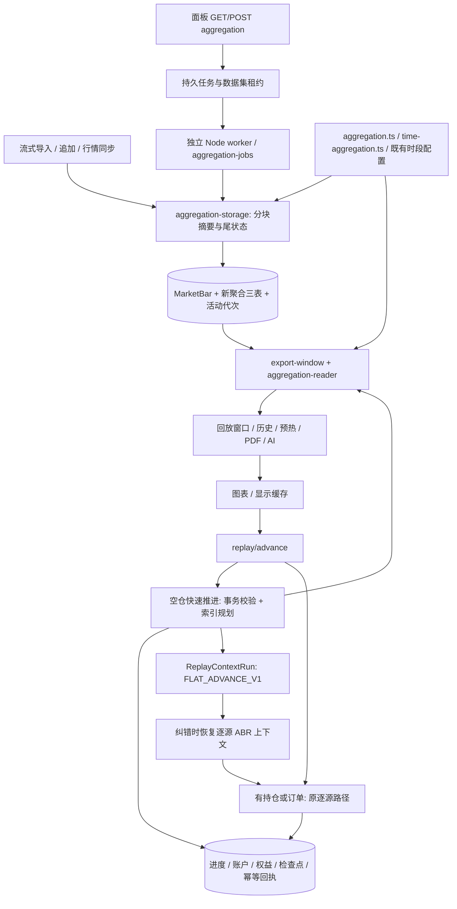

# 行情聚合重构、质量规则与回放推进优化：独立审查交接

编写日期：2026-10-20。面向未参与本次开发的架构师与代码审查者。

本报告覆盖本会话的完整开发范围：时间聚合替换与查询优化、聚合操作界面调整、稀疏秒行情的质量判定，以及空仓且无待处理订单的播放优化。报告用于审查，不表示所有设计已经获得独立验证。

## 1. 证据规则、版本与交付边界

### 1.1 如何理解本文的结论

- **已验证事实**：本次只读核对直接确认的 Git、源码和现存日志内容，或有明确日志/报告支持的历史执行结果。历史测试结果只对当时源码、数据副本和环境成立。
- **设计假设**：实现依赖的不变量、目标复杂度及业务解释；即使有部分测试支持，也不等于所有输入和部署环境均已证明。
- **待确认问题**：静态阅读发现的风险、尚无跨路径复现的疑点、未执行的验收及证据缺口。不能将其写成已复现故障，也不能将其省略。

本次编写仅创建本文件，没有修改业务、测试、依赖、配置或旧说明，没有运行迁移、业务测试、构建、服务重启或部署，没有提交和推送。测试章节整理的是此前开发过程留下的记录；本轮仅进行文档检查。

### 1.2 Git 审查范围（已验证事实）

| 角色 | 完整提交 | 说明 |
| --- | --- | --- |
| 需求实现前基准 | `9e3e81f4bcc77c7d6a8452ec3e28a658ede0dd4b` | `bbb5f24` 的直接父提交，标题“开发日报”。它是代码差异基准，不是经过标签认证的生产部署基线。 |
| 第一阶段 | `bbb5f24fabdd8293d2afad930ff933597a0aa137` | “聚合K线重构”，含时间聚合、查询替换、生命周期与界面调整。 |
| 待审查业务版本 | `51c6017dfb07091776e906b888f371bb13df09e6` | “优化空仓和没有待处理订单时的播放逻辑”，同时包含源记录质量规则及相关界面、迁移、测试。父提交为 `bbb5f24`。 |
| 本报告 | `docs/reviews/handoff.md` | 本轮新增，未包含在上述业务提交中。 |

推荐整体审查范围：`9e3e81f..51c6017`。不能只审查最后一个提交。整体差异为 **70 个文件：新增 23、修改 45、删除 2；新增 2,212 行、删除 752 行**。本轮开始时工作区干净。

可用以下只读命令定位范围：

```powershell
git log --oneline 9e3e81f..51c6017
git diff --stat 9e3e81f..51c6017
git diff --name-status 9e3e81f..51c6017
git diff 9e3e81f..51c6017
```

另有 `stash@{0}`，标题为 `wip/bar-emission-quality-before-playback-comparison-2026-10-20`，保留了体验对比前的阶段性改动。它不是当前待审查版本，不应再次应用作为审查前置操作。

**待确认**：没有核对远端生产实例、镜像摘要、生产数据库或部署记录，不能断言生产已经运行上述提交。也不能仅凭本机 Git 推断生产最初基线。

### 1.3 资料及证据位置

- 使用与存储说明：[时间聚合](../time-aggregation.md)、[空仓快速推进](../flat-replay-advance.md)。
- 数据升级与回退：[升级指南](../upgrade.md)。
- 行为约束：[回放多会话](../replay-sessions-implementation.md)、[行情同步](../market-data-sync.md)、[交易关卡](../training-gate.md)。
- 开发过程的专项日志、JSON、截图位于本机被忽略的 `tmp/`，不是随 Git 分发的审查附件。下文给出具体名称；交接到其他机器时应另行提供脱敏证据，不能假定文件存在。

已有文档存在时间性表述漂移：`flat-replay-advance.md` 末尾“代码未提交”已被当前 Git 事实取代；`time-aggregation.md` 中“仍逐源推进”须结合后续空仓数学等价分支理解，其早期“两个数据集待构建”和未进行视觉检查的描述也不是最终全阶段状态。本轮按文档限定未修改这些文件。

## 2. 需求来源、变化与实际范围

### 2.1 原始问题与最终约束

最初问题是：1min 源行情切到 6H 及更高周期很慢，需要查明查询复杂度退化，并比较修算法与按时间预计算的收益。旧系统使用 64/512/4096 根源记录块；讨论后用户选择将存储层一并改为时间聚合，同时修复查询。

用户最终明确：保留源行情、源序号、回放进度、会话及交易；不以预计算表限制周期选择；ETH/RTH 小时层必须区分；4H 必须是真正四小时，收盘短尾交给细层；提供导入自动构建和面板重建；移除旧构建、旧读取和后台补建，不双写、不回退旧表。

| 需求演进 | 最终决定 | 当前实现与验收界限 |
| --- | --- | --- |
| 只修查询，还是改时间聚合 | 同时实施 | 新时间层与有界范围读取已落地；旧两个运行模块删除。 |
| 是否仅预存 15min、不建 1H | 最终要求 ETH/RTH 1H 都落库 | 分别按对应时段开盘对齐，ETH 另有 4H。 |
| RTH 不足四小时的段如何处理 | 不存 RTH 4H；图表允许收盘短尾 | 使用 RTH 1H、共用分钟层与原始尾部合成，显示仍保留用户选择的周期。 |
| 是否可切其他周期 | 必须完整保留 | 校验仍为源周期整数倍且不超过 24H；没有对应存储层时执行通用查询。 |
| 老数据如何升级 | 不转换旧摘要，不自动全历史回填 | 删除旧表后，已有数据集需面板构建新代次；源周期可读，高于源周期未就绪返回明确错误。 |
| 重建 UI 太突兀 | 与同步行情区域一致 | 改为分隔线、状态文字与小型 outline 操作；成功时隐藏重复处理数量。 |
| 1s 导入后大量橙框 | 先核对源文件，再调整规则 | 增加源输出语义与独立质量判定；不以少秒柱自动认定 Databento 数据丢失。 |
| 点击“下一根”延迟高 | 先分析、stash 对照，再优化 | 用户反馈旧版体验相同；没有证据证明质量规则是主因。随后获准实施空仓快速路径。 |
| “没有待处理订单”是否足够 | 还必须没有持仓 | 服务端检查所有 PENDING 订单、残余 lot、未结束 trade 及账户状态，不仅看限价挂单。 |

### 2.2 最终预计算层

| 源数据 | BASE 共用层 | ETH 层 | RTH 层 |
| --- | --- | --- | --- |
| 1s | 60s、300s、900s | 3600s、14400s | 3600s |
| 1min | 300s、900s；60s 直接读原始表 | 3600s、14400s | 3600s |
| 其他源周期 | 仅保留上述大于源周期且为源周期整数倍的层 | 同左，且市场支持 ETH | 同左，且市场支持 RTH |

不预存 RTH 4H、8H、1D，不重复存源周期，不为每一种自定义周期建立持久层。按需合成结果主要进入显示缓存，而非动态扩展聚合表周期。

“市场实际支持的时段”在当前代码中不是外部交易所日历：`chart-sessions.ts` 对受支持的 CME 股指根符号提供 ETH/RTH，其他符号仅 ETH 并采用数据集配置。该既有识别范围没有扩展为所有市场。

### 2.3 验收标准与当前证据

| 验收标准 | 当前证据 | 尚不能据此断言的内容 |
| --- | --- | --- |
| OHLCV、源数量/序号、null volume 与直接逐源计算一致 | 单元与 SQLite 集成比较；真实文件与导入结果专项核对 | 尚未证明所有市场/任意异常输入都一致。 |
| ETH/RTH 分别对齐，完整 1H/4H 入库，短尾细层补齐 | 层级、短尾、DST、检查点分割测试 | 不含节假日、午休、提前收盘日历。 |
| 不提前揭示未来行情 | 摘要 lastSequence 限制、源读取双边界、未来哨兵和 HTTP 核对 | 桶是否已结束允许使用一个后继记录的时间元数据；不能称为完全不接触未来元数据。 |
| 任意合法周期继续可用 | 7s、61s、7/45/65/90min、2/3/4/6/12H、1D 等对照；分页测试 | 任意周期并不保证每页能返回申请的全部根数，也不保证统一耗时。 |
| 构建/取消/恢复/切换/追加/同步正确 | 持久任务和隔离 SQLite 测试；副本独立 worker HTTP 演练 | 未覆盖目标 Linux 镜像上的长期锁竞争与异常退出。 |
| 原行情、交易、会话保留，旧表不存在仍可读 | 两次结构升级与多轮副本数据摘要核对；测试查询 sqlite_master | 本轮未重新连接生产库验证。 |
| 查询不随全部历史反复扫描 | 有界 SQL、EXPLAIN、固定窗口扩展未来历史的结果/读取量不变测试 | 不构成严格的全输入运行时上界证明。 |
| 空仓优化不改变财务与纠错 | 逐字段账户/权益比较、故障回滚、ABR 还原与区间内回退测试 | 仍缺少完整浏览器点击耗时和更长混合交易链的专项对照。 |

## 3. 架构、模块依赖与数据流

### 3.1 架构边界

应用仍为 Next.js App Router + TypeScript + Prisma/SQLite；未引入新存储服务、队列服务或第三方依赖。`package.json` 只增加时间聚合基准命令，没有修改依赖版本或 lockfile。



核心依赖关系：

| 模块 | 职责与依赖约束 |
| --- | --- |
| `aggregation.ts` | 共享桶边界、交易日、增量合成与摘要归并；不依赖 Prisma。沿用 `@date-fns/tz` 处理本地交易时段和 DST。 |
| `time-aggregation.ts` | 层级、规则版本、时段指纹、流式摘要与可持久尾状态；依赖共享时间规则和既有市场配置。 |
| `bar-quality.ts` | 根据形成阶段、输出语义和缺口证据分类；独立于 OHLCV 存储代次。 |
| `aggregation-storage/jobs/reader` | 分别负责持久化、任务生命周期、摘要覆盖/原始补齐。只有这里及业务服务接触数据库。 |
| `export-window.ts` | 目标桶发现、分页、原始行预算、窗口与预热；复用 reader，成为多个展示/导出入口的共同服务。 |
| `paper-trading/flat-advance.ts` | 纯函数：空仓资格和恒定权益数学计算；不承接订单匹配。 |
| `market-replay/flat-advance.ts` | 数据库业务服务：资格复核、计划、采样、上下文与原子保存。 |
| `replay-sessions/flat-context.ts` | 纠错时恢复延迟上下文，依赖共享聚合/ABR 和窗口读取；因此纠错也依赖有效的新聚合代次。 |
| 页面/组件/API | 组件处理交互，API 校验和转发业务服务；客户端增量更新复用共享规则。原大型 replay client 未拆分。 |

### 3.2 构建与追加数据流

1. **新导入**：原有持久导入任务、CSV/CSV.GZ 流式解析及合约筛选保留；分块提交原始记录与聚合游标/尾桶状态。聚合计算出错时回滚当前事务，再保存合法原始块，后续不再尝试该失败代次；最终原始数据可 READY，活动聚合为空，可独立重建。
2. **面板构建**：创建 BUILDING 代次和 QUEUED 任务；独立进程按源序号每批 4096 条读取，提交摘要与任务检查点。直到目标源序号一致才把原 READY 代次标为 RETIRED、新代次 READY、切活动指针并完成任务；这些发布写入在同一事务。
3. **恢复/取消**：取消只设标记，worker 在批次间确认；失败/取消不覆盖当前可用活动代次。恢复要求源历史版本、规则、指纹和目标长度仍一致，否则必须新建重建。过期任务变 INTERRUPTED，等待明确恢复，不自动无限重试。
4. **追加/同步**：持有共同数据集租约，从活动代次尾状态生成暂存代次；只重算尾部与新增数据，随暂存原始尾部一起原子发布。未就绪的数据集不以仅计算新增尾部冒充全历史 READY。
5. **并发**：`MarketDatasetUpdateLease` 与活动任务唯一占位串行化重建、追加、同步和相关设置修改；租约 120 秒、心跳 20 秒；worker token 区分重启/重复进程，释放租约必须匹配 owner。
6. **清理**：RETIRED 成功代次至少保留 24 小时，后续任务分批每次 1000 条回收。读服务容忍被替换的 RETIRED 代次以支持在途请求。没有独立定时 GC。

**设计假设**：源序号无洞、时间严格递增且符合源网格；输入层已过滤不合法记录。游标连续性有检查，但并未在每次摘要读取中重新证明所有这些不变量。

### 3.3 查询数据流与复杂度

1. 读取请求明确的源揭示上界和锚点；索引定位真实存在的桶，跳过闭市和没有行情的时间段。
2. 每个目标桶保持独立边界，按可用层由大到小选择完全落入目标范围的摘要。共用 BASE 可复用；时段专用层还需 session key 相等。
3. 摘要要求 `bucketStart >= lower`、`bucketStart < upper`、`bucketEnd <= upper`、`lastSequence <= revealedSequence`。不能仅因目标是某层整数倍就复用，也不能仅因不是整数倍就拒绝复用。
4. 去除摘要覆盖后，合并相邻/重叠原始读取区间。每批最多 50 个参数化 `UNION ALL` 分支，每分支都有数据集与时间上下界；原始读取指定现有时间唯一索引。
5. 固定层数的有序流按源序号线性归并，送入共享聚合器。原始尾部还受揭示时间限制。摘要跨目标或揭示边界时降级细层/源数据。
6. 默认原始预算 25,000 行；超预算将候选页面减半并返回可继续的页。不能据此禁用自定义周期。单桶自身仍超预算时可抛 `WindowSourceBudgetError`，并非所有错误都已有专门用户文案，见风险 5。

**设计复杂度**：固定层数下全量构建 O(N)、工作内存随分块大小有界；窗口目标为 **O(I log N + K + W)**，I 为索引区间/查找数、K 为实际读取记录数、W 为规划/输出桶数。这是正常索引路径的模型，不包括所有驱动排序、网络、重试和序列化开销；极稀疏历史可能规划大量空桶，W 不能仅理解为最终非空输出数量。页面缩小重试也有额外读取。

旧退化不应归咎于“2 的幂”本身：缺少完整上界会多读后续块，多区间 OR 又可能只按 datasetId 扫描后过滤。若 Q 个查询批次各退化为扫描 N 条，模型最坏可达 O(QN)，再叠加合成成本；这不是说每个 OR 分支都必然独立扫描 N 条。时间层减少 K，有界索引查询消除反复扫描，属于两项独立收益。

### 3.4 时间、质量与显示

- BASE 使用 UTC 网格；会话桶从对应开盘对齐。24H 显示在有交易时段时代表一个交易日，跨 DST 可以不是固定 86400 秒；连续市场沿用 UTC 日界。
- 1H/4H 只保存桶的真实起止跨度满足该周期的摘要；这不代表源数据无缺失。收盘短尾留给细层，不跨时段补拼，不补造源柱。
- 当前 CME 股指配置为 Chicago ETH 17:00–次日 16:00、RTH 08:30–15:15，按交易日工作日处理。不是所有市场的小时柱都从半点开始，也未普遍实现交易所节假日日历。
- 1D 使用对应时段内实际 OHLC，不引入结算价/EOD 数据。
- `barEmissionMode` 为 `UNKNOWN`、`TRADE_DRIVEN`、`DENSE`。Databento CME 新导入自动选按成交输出；普通 CSV 默认 UNKNOWN，可在导入/设置明确声明；旧数据默认 UNKNOWN，不用文件名或密度猜测。
- `phase` 为 FORMING/CLOSED，`quality` 为 NORMAL/UNKNOWN/GAP，互相独立。明确缺口或源数量超理论数量为 GAP；已收盘 DENSE 少槽为 GAP；UNKNOWN 少槽为 UNKNOWN；TRADE_DRIVEN 少槽本身不构成 GAP。
- 兼容字段 `status` 保留：GAP→INCOMPLETE，否则 CLOSED→COMPLETE，否则 FORMING。**COMPLETE 已不等于经过供应商完整性验证**。图表只有 GAP 橙框；详情保留实际/理论源数量；PDF/AI 说明未知覆盖。
- 模式调整不改 OHLCV、不改 history/data version、不重建代次；显示缓存加入质量规则版本/模式，原始缓存保留原历史版本策略。真实缺口证据只有可选 `confirmedGap` 传播接口，没有新增供应商缺口证据持久表或完整采集链。

### 3.5 空仓快速推进与精确路径

**服务端资格**：在同一个写事务内检查会话可写、源历史/进度/账户版本、净持仓为 0、均价 null、没有 active cycle、没有任何 PENDING 订单、残余 lot 和 OPEN trade。不存在模拟账户也可推进。PENDING 包括市价、限价、止损、保护单及尚未生效订单；前端快照只是尝试提示。

**快速路径**：源序号和时间索引定位目标桶/末条记录，最多 512 次 seek；复用摘要读取已揭示 OHLCV，只取边界及权益采样所需的真实源记录。单次最多 86,400 条源推进、最多 4096 个权益点，密集采样时主动缩小源范围。前端最多 64 次有界续跑，保持下单与推进串行。

**财务等价假设**：空仓、无订单且当前费用模型下，区间内权益恒为 `initialCapital + realizedPnl - totalFees`；账户 version 仍按跨过的源条数递增，峰值/最大回撤用等价公式更新。保留原稀疏采样、原手动每 100 源补点和末点，隐藏时段沿原快进采样规则。采样时间取真实源记录，不插值。

**原子保存**：进度、账户、权益点、上下文、检查点、幂等回执同一事务保存；有账户时保留每 4096 源检查点。相同请求标识和参数重放原回执，不重复推进。条件不符或特定聚合不可用返回无写入结果，客户端转原路径。

**精确路径**：有任何持仓/待处理订单继续逐源撮合，订单生效序号、内部路径、FIFO/OCO 等沿用原引擎。普通源速自动播放仍读取和遍历源条数 B，空仓仅跳过重匹配；没有实现全部自动播放的聚合跳跃。因此“空仓不再 O(B)”仅适用于索引快速分支，不能推广到所有播放方式。

**客户端与缓存**：手动下一根在拉整日源分块前尝试快速分支；暂停空仓时不预取整日源数据，需要自动播放/精确路径时按需加载。返回聚合为完整桶修订，按 timestamp 替换，避免重试重复累加 volume。显示缓存同时区分聚合规则/代次及质量语义。

### 3.6 延迟纠错上下文

以前逐源生成变化 ABR 上下文；空仓快速期间不逐源计算，而在原 `ReplayContextRun.context` String/JSON 写 `FLAT_ADVANCE_V1` 描述，记录源 historyVersion、ABR 长度、显示周期/时段、客户端可用历史起点、显示时区偏移、tick size。

用户明确执行纠错时，`materializeFlatContexts` 按配方读取此前窗口，必要时多页恢复 ABR 历史，再对每条待重演源记录计算**处理该条之前**的 ABR、增量合成、形成原格式上下文，交给既有 correction runner。正常旧上下文仍兼容，纠错结果保存常规格式。

**兼容边界**：没有新增表，但增加了持久 JSON 协议。旧代码不能理解该配方，不能据“无新表”推导可直接回退。当前没有独立、可交付的批量展开旧格式工具。配方对未来规则变更的可重复性也是风险 3。

## 4. 数据模型与接口契约

### 4.1 结构变更

| 对象 | 主要字段/约束 | 使用时机 |
| --- | --- | --- |
| `MarketDataset` | 新增可空 `activeAggregationId`、`barEmissionMode` 默认 UNKNOWN；删除 `barBlockBuildCursor` | 定位活动代次、声明源输出语义；原源周期权威字段保留。 |
| `MarketAggregationGeneration` | datasetId、ruleVersion、historyVersion、fingerprint、cursor 默认 -1、tailState JSON 字符串、status、时间；datasetId/createdAt 索引 | 构建/恢复/追加尾状态与发布；源/规则/时段变化时判断有效性。 |
| `MarketAggregatedBar` | generationId、scope、intervalSeconds、bucketStart/End、first/lastSequence、first/lastTime、OHLCV、volumeCount、sourceCount、expectedCount | 有界窗口和快速推进读取；数量信息用于动态质量判定。 |
| `MarketAggregationJob` | datasetId、可空唯一 activeDatasetId、generationId、status、targetSequence、cursor、cancelRequested、workerToken、leaseUntil、error、时间 | 后台进度、互斥占位、检查点、取消/恢复/中断。 |
| `ReplayContextRun` | 表结构未改；context 内允许 `flatAdvance` 配方 | 空仓推进保存，纠错读取并还原。 |

聚合主键为 `(generationId, scope, intervalSeconds, bucketStart)`，同时支持前缀过滤与桶起点范围查找。源表既有 `(datasetId, sequence)` 与 `(datasetId, timestamp)` 唯一索引继续使用。活动指针是应用维护的可空 String，**不是数据库外键**；generation/job 的父子外键有级联/置空约束。错误指针由业务有效性检查拒绝，但数据库本身不会禁止写入悬空活动指针。

迁移 `20261020120000_time_aggregation` 直接 DROP 两张旧表，删除旧游标，新增三表/指针；`20261020150000_bar_emission_mode` 仅新增元数据列。`scripts/init-sqlite.mjs` 同步支持旧安装升级，不维护 Prisma migration history，不得用它跳过失败迁移。原始 `MarketBar` 不需要迁移/重算，但派生摘要必须新建。

### 4.2 API

| 接口 | 请求/成功响应 | 约束、失败与调用方 |
| --- | --- | --- |
| `GET /api/market-datasets/:id/aggregation` | `{ready,generationId,ruleVersion,buildFailed,job}`；job 含 id/status/processed/total/error/updatedAt | no-store；不存在 404。会探测过期租约并更新中断状态，因而不是完全无副作用的状态读取。面板活动任务约 1 秒轮询，空闲约 15 秒。 |
| `POST .../aggregation` | `{action: rebuild\|resume\|cancel, jobId?}`；成功 202 返回最新状态 | resume 必须 jobId；400 参数错、404 非 READY/不存在、409 忙或冲突。重复构建复用活动任务；独立 worker 竞争领取。cancel 是标记，不保证立即停止。 |
| `GET .../bars/window` | displayIntervalSeconds、displaySession、endSequence、visibleCount/warmupCount、可选 focusSequence；返回 visibleBars/warmupBars/lastSourceBar/分页与代次信息 | 校验合法源倍数/会话；高于源周期未就绪 409 `AGGREGATION_NOT_READY`。endSequence 为传入的读取上界，本次未新增认证体系。 |
| `GET .../bars/export-window` | anchorSequence/endSequence/dataVersion/displayIntervalSeconds/displaySession/direction/count/warmupCount；返回 bars/warmupBars/previousSequence/nextSequence | count 1–200、warmup 0–1000；开始/结束复核 dataVersion；409 版本冲突/聚合未就绪，no-store。 |
| `POST .../replay/advance`（新增分支） | `flatOnly:true`，requestId、expectedCurrentSequence、expectedVersion、historyVersion、count、displayIntervalSeconds/displaySession、abrLength、displayUtcOffsetMinutes、可选 abrHistoryStartSequence | 经 `withReplaySessionRoute` 保留会话/projection 写入限制；count 1–100、ABR 1–1000、显示≤86400 秒；flatOnly 要求 requestId 和显示周期。历史/版本错 409，EOF 400。 |
| 快速推进成功结果 | 原回放结果 + aggregatedBars、lastSourceBar、completedDisplayBucketStart、reachedVisibleBucket、服务端幂等参数 key | 进度可能仅完成有界部分，不能把 200 当成必定完成一整根目标柱。source/summaries 读取量在诊断 header 返回。 |
| 快速推进不适用结果 | `200 {flatAdvanceUnavailable:true}` | 必须在客户端作专门分支；不当作成功移动进度，也不等同版本冲突。只有特定“不就绪/原始预算”会转换为此结果，其余异常可传播。 |
| `PATCH .../market-datasets/:id` | 支持 barEmissionMode；返回修改后模式和周期相关信息 | 只改模式不重建/不改 historyVersion。源周期或价格语义变更沿既有检查，并清空活动指针、递增版本。 |

数据集摘要新增 `aggregationGenerationId`、`aggregationRuleVersion`、`aggregationStatus`、barEmissionMode。**已验证差异**：摘要 `aggregationStatus` 仅根据指针是否为空粗略推断 READY/PENDING；聚合状态接口 `ready` 则核对代次状态、版本、指纹和游标。严格可用性应以后者及 reader 校验为准。

OHLCV 为原有数值接口，volume 可 null；全 null 保持 null，部分非 null 则汇总已记录量。没有增加逐秒补值、汇率、结算价或额外成交事实。

## 5. 主要决策及未采用方案

| 决策 | 原因 | 考虑但未采用 / 代价 |
| --- | --- | --- |
| 用时间层替换 2 的幂源计数块 | 高周期可按真实边界少量读取，ETH/RTH 表达明确；同时消除旧范围查询退化 | 只给旧块补上界也可改善 SQL，但最终用户希望一步迁到时间规则；新摘要占用显著更多。 |
| 共同分钟层 + 独立会话小时层 | 分钟层复用高，小时层省去 RTH 半点/ETH 对齐的重复细读 | 仅 15min 虽表层简单，但大窗口 1H/4H/日线读取更多；不能共用 ETH/RTH 1H。 |
| 不为所有周期持久化 | 自定义周期组合多，不能用白名单限制；通用覆盖算法处理任意合法周期 | 预存每种周期会放大空间、导入与重建成本；按需结果只缓存。 |
| 完整时长层落库、短尾细层补齐 | 保证 4H 真是四小时，又保留收盘短柱显示语义 | 不把 2H45 标为完整 4H，不跨交易时段拼接；尾部查询更复杂。 |
| 新代次成功后原子切换 | 重建失败仍有可读版本，便于恢复 | 不原地清空旧代次；代价为临时双份空间、过期代次管理。 |
| 旧摘要直接移除、手动构建旧数据集 | 旧块无法可靠转换新时间语义；控制升级扫描量 | 不双写、不回退旧表、不自动扫描所有历史；升级后高周期暂不可用。 |
| 有界参数化 UNION ALL | 每个区间可索引查找，避免 OR 退化反复扫描 | 不用多区间大 OR、不做全历史浏览器加载；SQL 分支数、合并与预算逻辑需持续验证。 |
| 输出语义与质量分离 | 稀疏按成交 OHLCV 的空秒并非已证实丢失；不改真实价格 | 不补造秒柱、不按数量一概橙框、不把所有稀疏数据都当完整；UNKNOWN 需要明确披露。 |
| 仅严格空仓/无订单走索引快速分支 | 无成交风险时权益可数学等价推进；有持仓还需逐源权益和回撤 | 不采用“只要无挂单就跳过”的宽松条件，也没有对持仓/订单直接用聚合 OHLC 撮合。 |
| ABR 延迟到纠错还原 | 避免空仓普通点击逐源重算指标和大量上下文写入 | 不把整段 ABR 固定为终值或丢弃；代价为纠错更慢、持久协议和旧版兼容债务。 |
| 复用独立 Node worker 与 SQLite 租约 | 延续现有导入/纠错部署方式、浏览器关闭不丢任务 | 未引入外部队列；启动依赖 tsx/脚本打包，多进程租约复杂度仍需审查。 |

TradingView 官方材料只作为“交易时段收盘允许最后柱缩短”的展示规则参考，未据此声称复制其内部聚合算法。供应商源规则的历史调查也不能等价于对每段数据完整性逐笔验证。

## 6. 完整文件清单

以下状态以 `9e3e81f..51c6017` 的最终差异为准；A=新增、M=修改、D=删除。文件用途描述实际审查关注点，不表示每个文件都有大规模逻辑改写。除删除文件外均可通过仓库路径定位；删除文件请在基准提交查看。

### 6.1 API 与界面（12 个）

| 状态 | 文件 | 用途 |
| --- | --- | --- |
| A | `app/api/market-datasets/[id]/aggregation/route.ts` | 聚合状态、重建/恢复/取消与 worker 启动。 |
| M | `app/api/market-datasets/[id]/bars/export-window/route.ts` | 新读取服务的未就绪错误契约。 |
| M | `app/api/market-datasets/[id]/bars/window/route.ts` | 替换旧块/源区间读取，分页、代次与读取行诊断。 |
| M | `app/api/market-datasets/[id]/market-dataset-api.test.ts` | 模式设置不改价格、代次和进度的回归。 |
| M | `app/api/market-datasets/[id]/replay/advance/route.ts` | flatOnly 分派、诊断及质量/闭桶兼容。 |
| M | `app/api/market-datasets/[id]/route.ts` | 模式元数据、语义变化时使聚合失效。 |
| A | `components/market-replay/bar-emission-mode-field.tsx` | 导入/设置共享源输出模式选择。 |
| A | `components/market-replay/market-aggregation-control.tsx` | 聚合状态轮询、构建/取消/恢复/确认及与同步一致的布局。 |
| M | `components/market-replay/market-dataset-dashboard.tsx` | 面板接入聚合操作、模式表单及刷新。 |
| M | `components/market-replay/market-replay-client.tsx` | 快速推进尝试/续跑、按需源预取、显示缓存与增量质量更新。 |
| M | `components/market-replay/replay-chart.tsx` | 仅 GAP 橙框、阶段/质量及实际记录详情。 |
| M | `lib/i18n.ts` | 集中中文聚合操作、模式、质量与导出文案。 |

### 6.2 行情业务与缓存（31 个）

| 状态 | 文件 | 用途 |
| --- | --- | --- |
| M | `lib/market-replay/advance-display.ts` | 已关闭质量更新的缓存持久化、尾柱合并。 |
| A | `lib/market-replay/aggregation-jobs.ts` | 队列、游标、租约、取消恢复、原子发布、退休代次清理。 |
| A | `lib/market-replay/aggregation-reader.ts` | 多层摘要覆盖、有界 UNION ALL、原始补齐、预算与指标。 |
| A | `lib/market-replay/aggregation-storage.ts` | 代次有效性、分块摘要、追加暂存/发布、未就绪异常。 |
| A | `lib/market-replay/aggregation-worker.ts` | detached Node 聚合进程启动。 |
| M | `lib/market-replay/aggregation.ts` | 共享时间与日历修正、摘要合成、phase/quality 与增量更新。 |
| M | `lib/market-replay/append-import.ts` | 删除旧计数块，续算新尾桶、原子发布、按成交模式间隔处理。 |
| D | `lib/market-replay/bar-blocks.ts` | 删除旧源记录块构建、读取与后台补建模块。 |
| M | `lib/market-replay/bar-cache.ts` | 显示缓存加入代次/规则/模式与质量版本。 |
| A | `lib/market-replay/bar-quality.ts` | 输出语义、独立质量状态和兼容 status。 |
| M | `lib/market-replay/chart-data.ts` | 图表数据按真实 GAP 上色。 |
| M | `lib/market-replay/chart-snapshot-caption.ts` | PDF/AI 图像形成中、缺口、未知完整性说明。 |
| M | `lib/market-replay/export-window.ts` | 统一目标桶、源预算、自适应分页、窗口与预热。 |
| A | `lib/market-replay/flat-advance.ts` | 空仓快速路径数据库服务和原子状态保存。 |
| A | `lib/market-replay/flat-display-plan.ts` | 索引定位可见桶、隐藏时段与源推进上限。 |
| M | `lib/market-replay/history.ts` | 以新层级估算页面大小，保留历史合并。 |
| M | `lib/market-replay/import-file.ts` | 移除旧块累积器，保留流式文件基础设施。 |
| M | `lib/market-replay/import-jobs.ts` | 导入自动聚合、独立失败保留原始数据、自动源模式。 |
| M | `lib/market-replay/replay-sync.ts` | 常规源循环中空仓轻量权益分支，有订单沿原匹配。 |
| M | `lib/market-replay/serialize.ts` | 数据集聚合/模式摘要字段。 |
| A | `lib/market-replay/time-aggregation.ts` | 时间层、指纹、流式 OHLCV 与 checkpoint 尾状态。 |
| M | `lib/market-replay/types.ts` | 删除旧块常量，新增模式/phase/quality/聚合摘要类型。 |
| M | `lib/market-replay/use-replay-window-cache.ts` | 窗口缓存作用域加入新版本/代次与模式。 |
| D | `lib/market-replay/window-service.ts` | 删除旧窗口源区间/块选择服务，改由 export-window + reader。 |
| M | `lib/market-sync/engine.ts` | 同步新尾聚合与源数据同时发布、继承模式。 |
| M | `lib/market-sync/lease.ts` | 聚合任务占位/过期恢复接入共享数据集互斥。 |
| A | `lib/paper-trading/flat-advance.ts` | 空仓资格、恒定权益、版本和样本序号纯函数。 |
| M | `lib/replay-sessions/context-runs.ts` | 新增 FLAT_ADVANCE_V1 配方类型。 |
| M | `lib/replay-sessions/context-storage.ts` | 持久化并合并延迟上下文。 |
| M | `lib/replay-sessions/correction-runner.ts` | 纠错源批次前恢复配方上下文。 |
| A | `lib/replay-sessions/flat-context.ts` | 分页恢复 ABR 历史及逐源上下文展开。 |

### 6.3 其他业务、测试（16 个）

| 状态 | 文件 | 用途 |
| --- | --- | --- |
| M | `lib/ai/chart-tools.ts` | 图表工具覆盖状态区分 GAP/UNKNOWN/按记录。 |
| M | `lib/validations.ts` | 模式与快速推进参数、依赖字段、历史起点边界校验。 |
| M | `lib/ai/ai.integration.test.ts` | AI 行情测试数据接入新聚合构建。 |
| M | `lib/market-replay/advance.integration.test.ts` | 真实 SQLite 推进等价、订单/持仓回退、回执、故障、ABR、EOF/会话/自定义周期等。 |
| A | `lib/market-replay/aggregation.integration.test.ts` | 新生命周期、旧表不存在、任意周期、预算/索引/历史扩展回归。 |
| M | `lib/market-replay/aggregation.test.ts` | 共享聚合结果与状态语义适配。 |
| M | `lib/market-replay/bar-cache.test.ts` | 缓存版本/代次隔离。 |
| A | `lib/market-replay/bar-quality.test.ts` | 输出模式、形成阶段、缺口传播、EOF、导出与缓存。 |
| M | `lib/market-replay/chart-hide-after.test.ts` | 隐藏边界预期改用新质量语义。 |
| M | `lib/market-replay/chart-rewind.test.ts` | 回退图表状态适配。 |
| M | `lib/market-replay/export-window.test.ts` | 新代次窗口、揭示限制、跨日/DST 预热。 |
| M | `lib/market-replay/history.test.ts` | 新页面估算与旧块期望移除。 |
| M | `lib/market-replay/import-jobs.integration.test.ts` | 模式、聚合独立失败、追加尾状态、去重/取消/重试。 |
| A | `lib/market-replay/time-aggregation.test.ts` | 层级、完整时长、流式分割、缺失/null volume、DST 交易日。 |
| M | `lib/market-sync/engine.integration.test.ts` | 同步测试核对新摘要。 |
| A | `lib/paper-trading/flat-advance.test.ts` | 空仓纯函数对照逐源引擎、资格与采样。 |

### 6.4 结构、运行脚本与文档（11 个）

| 状态 | 文件 | 用途 |
| --- | --- | --- |
| M | `.dockerignore` | 排除 tmp、导入暂存、SQLite WAL/SHM，防止私有数据进入构建上下文。 |
| M | `package.json` | 增加 `benchmark:time-aggregation`，无依赖版本变更。 |
| A | `prisma/migrations/20261020120000_time_aggregation/migration.sql` | 删除旧块结构、创建新代次/摘要/任务。 |
| A | `prisma/migrations/20261020150000_bar_emission_mode/migration.sql` | 新增 UNKNOWN 默认的源输出模式。 |
| M | `prisma/schema.prisma` | 同步新模型、索引、关系与元数据。 |
| A | `scripts/benchmark-time-aggregation.ts` | 仅可丢弃副本上的构建/窗口性能及 dbstat 占用。 |
| M | `scripts/init-sqlite.mjs` | 同步旧安装结构升级/初始化。 |
| A | `scripts/market-aggregation-worker.ts` | 独立聚合任务执行入口、退出与断连。 |
| A | `docs/time-aggregation.md` | 时间规则、查询、源质量、迁移及阶段测试报告。 |
| A | `docs/flat-replay-advance.md` | 空仓语义、持久上下文兼容、性能与验证。 |
| M | `docs/upgrade.md` | 聚合迁移、既有数据集构建、worker 打包与回退注意事项。 |

以上分组 12 + 31 + 16 + 11 = 70。本报告另新增 1 个文档文件。未修改但需要关联审查的核心依赖包括 `chart-sessions.ts`、`display-advance.ts`、`abr.ts`、`paper-trading/engine.ts`、`replay-sessions/scope.ts`、`checkpoint.ts`、SQLite 驱动与原导入 worker；未修改不代表不可能与新路径产生交互问题。

## 7. 已实现、未实现与技术债

### 7.1 当前已实现（源码及相应阶段测试支持）

- 新时间层、通用覆盖读取、源区间有界查询、自定义周期与分页预算；原始数据仍保持原序号。
- 导入时自动构建、追加/同步尾部维护、持久面板重建、取消/恢复、中断检测、原子代次切换。
- 旧运行构建/读取退出；运行代码没有旧表 fallback。迁移历史、旧 schema 测试 fixture、初始化删除语句仍出现旧表名，属于必要历史兼容资料。
- 聚合 UI 对齐同步区域；源输出模式设置、质量分类、橙框/详情、PDF/AI 说明与缓存隔离。
- 严格空仓手动下一根快速分支、正常路径空仓轻量计算、恒定权益及真实采样、幂等和事务回滚。
- 延迟 ABR 上下文、纠错时分页恢复、区间内回退和检查点。

### 7.2 未实现或明确不在本次范围

- 交易所完整节假日、午休、提前收盘日历；当前配置不能代表所有市场。
- 独立日线/结算价提供方；日线仍由对应时段源行情合成。
- 每个自定义周期专用持久层、8H/1D 专用层、RTH 4H 层。
- 对供应商真实丢秒的完整证据采集/持久化与自动修补；TRADE_DRIVEN 不等于供应商数据完整证明。
- 对有持仓或挂单区间直接跳过源撮合；全部自动播放/所有日期快进改用摘要；无条件 O(1) 跳跃。
- 新延迟上下文批量转换回旧协议的独立工具；升级后新交易安全回退的完整演练。
- 大规模纠错性能专项、目标 Linux/Docker 实机验收、浏览器完整点击耗时与生产冷热负载压测。
- 自动扫描所有历史回填；迁移后需要按数据集操作构建。

### 7.3 已知限制与债务

1. 所有高于源周期的窗口都要求有效新代次，即使某个请求最终主要用源记录也如此；这是明确的运维门槛。未构建数据集不能靠旧摘要兜底。
2. 新摘要存储明显放大。退休代次 GC 只随任务触发；FAILED/CANCELLED/失效 BUILDING 代次不在当前退休清理选择条件中，反复新建而不恢复可能积累空间。
3. 活动指针无 FK、任务/代次状态为字符串（包括 `APPEND:<id>`），恢复与合法状态转换主要靠代码维护；导入聚合失败代次不保存详细独立错误诊断。
4. 列表摘要与聚合 GET 的 READY 判断严格程度不同；规则升级但旧指针仍在时，前者可能先显示 READY，实际查询拒绝。
5. `phase/quality/status` 三套兼容字段共存；COMPLETE 含义变化需要检查本次未改到的所有外部消费方。
6. 空仓实现增加第二条推进计划/持久化分支；重复业务不变量未来容易漂移。需集中验证跨分支等价，而不只分别测试。
7. ABR 的工作从普通点击转移到纠错，未消除；长配方批次反复分页预热会增加纠错成本。配方读取依赖当前聚合可用性。
8. 快速推进历史基准脚本、完整性摘要、UI 截图只在忽略目录，不能直接在另一台机器复现；已提交的时间聚合基准只覆盖其当前预置组合。
9. 基准脚本用 `--disposable-copy` 声明安全范围，但不能技术上证明该路径确为副本；应人工核实目标库，不能把该参数当隔离保障。
10. 本机历史 UI 检查与后续服务端优化验证属于不同阶段，不能把早期截图标成最终提交全部交互已重新验收。

## 8. 测试、实际命令与证据

### 8.1 已运行命令与结果（历史执行，本轮未重跑）

| 阶段 | 实际命令/操作 | 记录结果 | 本机证据与边界 |
| --- | --- | --- | --- |
| 时间聚合初次全量 | `corepack pnpm test` | **失败**：1 项逐源 ABR/FIFO/权益测试超过原 5s；1082 通过、2 跳过 | `tmp/time-aggregation-final-tests.log`。不能写成默认并发全量通过。 |
| 时间聚合限制并发全量 | `corepack pnpm test --maxWorkers=4 --minWorkers=1` | 122 文件通过、1 文件跳过；1083 测试通过、2 跳过 | `tmp/time-aggregation-final-tests-bounded.log`；没有通过放宽该 5s 或跳过失败项掩盖问题。 |
| 源质量规则全量 | `corepack pnpm test --maxWorkers=4 --minWorkers=1` | 123 文件通过、1 跳过；1098 测试通过、2 跳过 | `tmp/bar-quality-full-tests.log`，是中间阶段数量。 |
| 快速推进最初专项 | 下面专项命令 A | **失败**：5 项失败、110 通过、1 跳过 | `tmp/flat-advance-targeted-tests.log`；涉及自定义 UTC 网格起点和 legacy 会话回退 fixture 预期。 |
| 快速推进后续专项 | 下面专项命令 B | 2 文件通过；56 测试通过、1 跳过 | `tmp/flat-advance-focused-tests.log`；在最后两项长/短 ABR 历史测试加入之前，不是最终总数。 |
| 最终全量 | `corepack pnpm test --maxWorkers=4 --minWorkers=1` | **124 文件通过、1 文件跳过；1119 测试通过、2 跳过** | `tmp/flat-advance-full-tests.log`，14:35:10 开始，35.55s。最终 advance 文件为 53 tests、1 skipped。 |
| 类型 | `corepack pnpm exec tsc --noEmit` | 通过 | `tmp/flat-advance-types.log` 对应 14:22 阶段；后续最终 build 也完成类型检查。不能把这个较早独立 tsc 日志说成最后一项测试修改后的再次独立执行。 |
| 最终 lint | `corepack pnpm lint` | 通过 | `tmp/flat-advance-lint.log`，14:36 阶段；执行 eslint。 |
| 最终构建 | `corepack pnpm run build` | 通过 | `tmp/flat-advance-build.log`，14:37 阶段，`prisma generate && next build`、Next 15.5.18；早前沙箱 spawn EPERM 后重新执行成功，不是所有尝试首次成功。 |
| 初版/质量/UI lint、types、build | 同上相应命令 | 历史阶段通过 | `tmp/time-aggregation-final-lint.log`、`time-aggregation-final-build.log`、`bar-quality-{lint,types,build}.log`、`aggregation-ui-{lint,types,build}.log`；不能替代最终范围的检查。 |
| Prisma 空库迁移链 | `corepack pnpm exec prisma migrate deploy`，指定隔离副本/空库环境 | 初版 39 个、质量版本 40 个迁移成功 | `tmp/bar-quality-migrations.log` 明确 40 migrations 和成功应用；初版见阶段报告。环境覆盖完整命令没有全部保留，不能宣称在正式库执行了此命令。 |
| 原安装初始化升级 | `node scripts/init-sqlite.mjs`，备份后针对本机原安装路径及隔离副本 | 结构升级和数据核对记录成功 | 不与 Prisma migration history 混用；本轮未执行。 |
| 时间窗口基准 | `corepack pnpm benchmark:time-aggregation <绝对副本路径> --disposable-copy --build` | 产生逐场景耗时、读取行数与 dbstat 结果 | 路径是历史可丢弃副本；不是生产压测，不应复制占位符为正式执行目标。 |

专项命令 A：

```powershell
corepack pnpm exec vitest run lib/market-replay/advance.integration.test.ts lib/replay-sessions/sessions.integration.test.ts lib/replay-sessions/training-gate.integration.test.ts lib/market-replay/bar-quality.test.ts --maxWorkers=1 --minWorkers=1
```

专项命令 B：

```powershell
corepack pnpm exec vitest run lib/market-replay/advance.integration.test.ts lib/paper-trading/flat-advance.test.ts --maxWorkers=1 --minWorkers=1
```

最初 5 个失败后，测试数据改为明确 UTC 网格起点，并为允许回退的场景使用非 legacy 的 LIVE_REPLAY fixture；最终全量通过。审查者仍应检查这些 fixture 是否足够代表真实数据，不能因“是测试预期问题”便跳过对相位和会话限制的审查。

日志中的注入事务失败、模拟 503 和错误栈是故障回滚用例的预期输出；以 Vitest 最终断言和汇总为准。最终构建通过并不代表生产镜像含独立 worker 或目标机原生驱动可用。

### 8.2 跳过项和覆盖缺口

最终两项跳过分别为：

- `lib/replay-sessions/scale.integration.test.ts`：需 `REPLAY_SCALE_TEST=1`，20M 逻辑源规模重建测试，未在最终命令启用。
- `lib/market-replay/advance.integration.test.ts`：需 `REPLAY_BENCHMARK` 的 1s→5min 与原生 5min 基准，未在最终命令启用。

这些不是通过项。虽然另有实际副本专项基准，也不能把它们写成上述 opt-in 测试已执行。

已覆盖的关键点包括：多层/原始对照、1s/1min、自定义周期、ETH/RTH、DST、完整时长与 null volume、分页连续性、租约过期/owner、取消恢复、代次切换、导入独立失败、追加/同步、订单类型与未来保护单、残留持仓、故障原子回滚、幂等回执、账户/权益逐字段等价、ABR 长历史分页和快速区间内部回退。

覆盖的局限：不少预期值与新实现共享 `getAggregationBucket`、共享合成器和 ABR，能证明优化与共享规则一致，**不能独立证明规则本身符合每个交易所定义**。索引集成测试还使用简化 SQL；现存真实 EXPLAIN 是较强补充，但不是每个动态分支和预算重试路径的全覆盖。

### 8.3 数据保护与源文件核对（历史事实）

| 核对 | 结果 | 证据及限制 |
| --- | --- | --- |
| 初版结构升级前后 | 46 张原有业务表逐行摘要一致；1,783,470 根原始行情，integrity ok、FK 无异常 | `tmp/time-aggregation-data-check.json`、`time-aggregation-local-data-check.json`；新增派生结构不计作业务数据改变。 |
| ES 1s 原文件与导入 | CSV 1,425,302 行；合约选择后 1,219,997 行，另 205,305 行为筛选排除；DB 的时间/OHLCV/源序号全部匹配，无额外记录 | `tmp/second-source-import-check.json`；原文件由用户提供，路径未复制到报告。只能证明导入选中行未丢，不证明供应商原件无漏报。 |
| 源质量列迁移副本 | 原有表旧字段一致，3,003,467 根源数据，活动代次保留 | `tmp/bar-quality-copy-check.json`；按迁移允许排除新增字段/更新时间及运行租约。 |
| 最终播放优化前后原库摘要 | 48 张业务表、3,003,467 根源数据一致，完整性 ok | `tmp/flat-advance-data-check.json`；排除持续心跳的 `MarketSyncSchedulerLease`，真实用户会话没有被基准推进。 |

这些摘要只能证明相应时间点和纳入字段的相等性。本轮未重新计算 DB 摘要，也未重新核对当前运行服务。备份、原主密钥和环境保持的历史记录不能替代独立审查者的实际恢复演练。

### 8.4 界面验证范围

- 聚合 UI 调整阶段：375px/1440px 截图与移动端检测；`tmp/aggregation-ui-mobile-check.json` 记录无文档横向溢出、按钮高 40px、确认后焦点恢复；截图 `aggregation-ui-redesign-{desktop,mobile}.png`。
- 源质量阶段：历史记录覆盖 375/1280/1440/1920px、模式选择键盘展开/Escape/焦点返回、长按柱详情与控制台；证据示例 `tmp/bar-quality-settings.png`、`bar-quality-tooltip.png`。
- 最后空仓优化阶段：CLI、测试、隔离 HTTP 验证；**没有重新测浏览器完整点击耗时，没有最终固定视口视觉验收**。历史视觉证据不能证明加载、串行控制和所有交互均无回归。

## 9. 性能与空间：已测结果及不能外推的部分

### 9.1 时间聚合查询

本机 native SQLite / DELETE，1min MGC 1,746,688 源，返回相同 500 柱；旧算法复现与新完整窗口路由的后端进程内测量：

| 周期 | 旧中位数 / P95 | 新中位数 / P95 | 新源行 / 摘要行 |
| --- | --- | --- | --- |
| 6H | 12,708 / 13,411 ms | 54 / 56 ms | 0 / 1,448 |
| 8H | 13,986 / 14,328 ms | 43 / 60 ms | 0 / 967 |
| 1D | 17,244 / 21,868 ms | 90 / 114 ms | 0 / 2,568 |

结果支持这些固定窗口显著减少读取和后端时间；**不是页面端到端数百倍承诺**。旧端为旧算法复现，新端包含窗口 API；未包含浏览器/HTTP，未清空 OS 文件缓存，重复仅五次，P95 实际为样本最大值。不能将“首次请求”写成磁盘冷读。原计划 5–20 倍只是实施前估算，并非 SLA。

同机 better-sqlite3/WAL/FULL 的 6H、8H、1D 新窗口中位数约 142、110、135ms，读取行数相同；驱动与诊断配置不同，不可直接套用 native 毫秒数或归因 WAL 更慢。扩展未来历史回归核对了固定窗口结果和实际行数不变；尚无完整历史规模、冷热缓存和并发矩阵。

`tmp/time-aggregation-query-plan.json` 的源分支为 `SEARCH ... MarketBar_datasetId_timestamp_key (datasetId=? AND timestamp>? AND timestamp<?)`，摘要为聚合主键前缀和 bucketStart 双边界查找。该证据支持修复已发现的 OR/缺上界退化，不排除其他查询退化。

### 9.2 空仓手动推进

ES 1s 实际 RTH 小时内 3,521 条源记录；五组独立空仓副本会话，旧 `bbb5f24` 路由/同步逻辑与新快速路由比较：

| 指标 | 原路径 | 快速路径 |
| --- | --- | --- |
| 请求数 | 4 | 1 |
| 读取源行 | 3,521 | 99（边界、采样，包含重复读取） |
| 摘要行 | 0 | 2 |
| 权益点 | 93 | 93 |
| 中位数 | 124.4ms | 22.1ms |
| P95（五组最大值） | 138.5ms | 53.9ms |

账户和每个权益点逐字段一致，后端中位数约 **5.6 倍**。`tmp/flat-advance-benchmark.json` 给出样本；脚本 `tmp/benchmark-flat-advance.mjs` 是本机辅助工具，未提交。对比不含 HTTP、浏览器和整日原始缓存冷加载。

隔离生产模式 HTTP 服务另一窗口推进 3,393 源，返回 2 条聚合修订，读 94 源/2 摘要，约 125ms HTTP，其中路由诊断约 52.6ms；重试幂等且无未来 OHLCV。证据 `tmp/flat-advance-http-check.json`。这是一条连通性样本，不能作为稳定 P95。

质量规则阶段的微基准只出现毫秒以下到约 1ms 的局部增量，不足以解释用户当时的高延迟；用户恢复旧版后也报告体验相同。1s 数据导致普通路径源条数/网络分块放大是合理诊断，但原始浏览器慢点击没有完整 trace，根因占比仍待确认。

### 9.3 构建及空间

- 本机约 175 万根 1min 重建约 77s；100 万根合成 1s 约 32s。仅为对应机器样本，不是固定吞吐保证。
- 原两数据集源表及索引约 292.70MiB，新聚合及索引约 87.84MiB，约 **30.01%**；旧块约 6.07MiB，约 **2.07%**。新旧比例差异明显，不能说时间方案空间收益有限就忽略迁移容量。
- 空间样本主要来自当时两个分钟数据集，不能直接外推 1s、市场比例、失败代次和多版本峰值。重建还需容纳新旧代次、日志和备份；删除记录只释放 SQLite 页，不自动缩小文件。

## 10. 最容易出问题的五个地方

以下按建议审查优先级列出，**不是已经完成的独立审查结论**。每项分开陈述证据、风险与待验证动作。

### 1. 揭示边界、EOF 与收盘状态在不同推进路径间漂移

**已验证源码事实**：共享质量规则不以 EOF 自动收盘；快速路径 `flat-display-plan.ts` 在 EOF 可 `reachedVisibleBucket=true`，但短尾保留 `completedDisplayBucketStart=null`，其集成测试要求 FORMING。未修改的 `display-advance.ts` 在 EOF 达到请求桶数时却把最后桶设为 completed；普通 advance 路由又在 reachedVisibleBucket 时关闭形成柱。快速规划还读取后继记录的时间以认定桶结束。

**风险推断**：同一未到桶末尾的文件，空仓快速、有持仓/挂单回退、刷新窗口可能显示不同 phase/status，DENSE 下也可能改变 GAP 判定。这里已发现静态分支差异，**本轮没有运行对照复现，不能写成确定用户故障**。未来价格不泄漏与未来“时间存在性”是否允许也应明确。

**审查建议**：构造相同稀疏/密集 EOF 和跨闭市输入，对原窗口、普通 advance、flatOnly 和客户端增量逐字段比较；检查 no-lookahead/有 lookahead 情形及当日日线。共享函数对照不能代替多入口行为比较。

### 2. 代次、租约、追加发布与派生数据生命周期

**已验证事实**：活动指针无 FK；正常全量发布原子，追加把暂存摘要移动到活动代次；120s 租约/20s 心跳；读允许 RETIRED；GC 只清理超 24h RETIRED，失败/取消代次可残留；列表摘要仅按指针估算 READY。

**风险推断**：长批次、SQLite 写锁或 heartbeat 失败可能导致旧 worker 与恢复进程竞争；追加准备/发布期间源版本变化、读缓存持有退休代次、清理与读取交错可能暴露一致性缺口。连续失败/重建可能吃满磁盘，磁盘不足又影响原始导入。现有 owner/中断测试缩小了风险，未证明所有跨进程时序。

**审查建议**：在副本注入心跳阻塞、进程 kill、重复 worker、追加/同步/元数据修改冲突与空间不足；检查指针/状态/游标/任务一体不变量，确认过期数据与失败代次清理策略及页面状态契约。

### 3. 空仓数学等价、延迟 ABR 和持久协议可重复性

**已验证事实**：严格资格在事务内复核；常量权益/版本/采样与基准一致；`FLAT_ADVANCE_V1` 存当前 historyVersion、显示设置等，但没有冻结聚合规则版本或完整解析后的时段指纹；还原使用当前共享时间/ABR 实现和有效新代次。旧代码不能解释该记录。

**风险推断**：未来更改时段、ABR、聚合规则但未同步升级配方协议时，相同历史版本可能重算出不同上下文；客户端实际历史起点是还原的重要输入。未来若增加空仓随时间费用/利息，恒定权益假设也会失效。长配方纠错成本可能被低估；混合“空仓快进→挂单/成交→再次快进→删除早期周期”需要比单段回退更强证据。

**审查建议**：检查全部财务/统计/训练关卡不变量和账户版本、检查点命令顺序；补独立混合命令重演对照；确认配方版本升级策略、历史规则冻结和回退转换工具。当前无工具不能用“先展开即可”视为已具备安全回退。

### 4. 源输出语义误判与迁移/回退风险

**已验证事实**：Databento 格式自动 TRADE_DRIVEN，未知默认 UNKNOWN，模式可改且不重建；真实源文件选中行与 DB 相同。`confirmedGap` 有传播接口但无本次新增的持久证据链；COMPLETE 兼容字段含义改变。旧块表迁移不可逆删除，新质量列默认 UNKNOWN。

**风险推断**：错误声明 TRADE_DRIVEN 会隐藏仅凭缺槽能检测到的供应商漏报；错误声明 DENSE 又会大面积橙框。只检查 status 的旧消费者可能把 UNKNOWN 当已验证完整；迁移后无摘要的停用期和回退旧代码读新结构也可能影响生产可用性。

**审查建议**：复核格式识别/供应商契约和旧数据标注来源，搜索所有 COMPLETE/INCOMPLETE 消费方，验证显式缺口实际如何注入；在副本完成迁移、逐数据集构建和匹配备份恢复演练，检查工作进程打包与原密钥保留。不要用重置数据库消除迁移失败。

### 5. 通用查询、资源预算与真实端到端性能

**已验证事实**：正常查询有明确双边界与参数化分支；特殊周期会降级更多源读取、页面减半重试；单桶超预算可能抛异常。快速推进事务超时上限 120s，可多次 seek/采样写入；普通自动播放和有订单/持仓仍按源条数执行。基准为本机小样本，opt-in 大规模测试未运行。

**风险推断**：O(I log N+K+W) 在空桶、无兼容摘要源周期、复杂自定义周期和重试下仍可能昂贵；行指标不等于实际扫描页或 SQL 时间。单桶预算异常尚可能表现为一般 500，前端 flatOnly 对非指定错误也不能安全当无写入回退。大量采样或长写事务会影响同库其他操作。后端局部提速可能被原始缓存冷加载、请求往返、IndexedDB 和渲染抵消。

**审查建议**：对 1s/1min/无兼容层源、ETH/RTH、7s/61s/7/65/90min/6H/1D 做完整 API+浏览器固定窗口、首请求/热请求、历史扩容和采样密度矩阵；记录 EXPLAIN、扫描/返回量、SQL/事务时间、中位/P95、网络和前端耗时。明确预算异常、续页及 64 次续跑耗尽后的用户行为；在目标磁盘和生产镜像重新验收。

## 11. 交给审查者的下一步（建议，未执行）

建议先审查新迁移与存储不变量，再沿“目标桶→摘要覆盖→源补齐→增量呈现”的路径检查；随后审查空仓资格、恒定权益/采样和延迟纠错协议。重点不只在删除的旧块模块，未改动的普通计划器与新分支交互也要纳入。

独立验收可使用可丢弃数据副本和新会话，覆盖：导入 1s/1min、各输出模式、已有数据集待构建、重建取消/恢复/失败、追加与同步、所有合法自定义周期、ETH/RTH/日线/短尾、刷新/缓存失效、空仓/各种 PENDING/持仓下一根、自动播放/跨闭市、下单成交、FIFO/OCO、快速区间内回退与删除早期周期、PDF/AI 未知覆盖说明。尤其增加风险 1 的跨路径 EOF 对比和风险 3 的混合交易链。

正式升级时仍须遵循升级指南：核对实际库与原迁移方式，停止相关写入并保留一致性备份/密钥，先副本迁移，不自动回填全历史；逐数据集构建后验收。目标环境的 worker、驱动、日志模式、恢复点和镜像版本需独立记录。本报告没有授权或执行这些操作。

本轮文档检查已执行：`git diff --check` 通过；另直接读取新增文档核对 70 个清单条目与 Git 状态/路径完全一致、相对链接存在、无行尾空白。新增文档尚未进入 Git 索引，因此上述直接检查也覆盖了普通 `git diff --check` 不检查的未跟踪文件。没有重跑业务测试或构建。
